# Does the optimizer change how in-context learning emerges? Pilot and verification

*Initial tests of the CS 182 proposal by Chu, Dao, Hu & Cha, followed by a verification pass:
reproductions of the cited papers, per-condition hyperparameter search, and confirmation runs on
fresh seeds with held-out prompts. CPU-only, November 2026. Code in `icl_optim/`, figures in
`icl_optim/figures/`.*

**Bottom line (after verification).** The proposal's central claim survives, with smaller and
more qualified effects than the pilot reported.
- In the 4L/4H/128d GPT-2, Muon learns in-context linear regression faster than AdamW: 4.3×
  faster to converge on isotropic inputs and 6–7× under λ ∝ 1/i².
- Under 1/i², Muon learns the weakest input direction 7× sooner. At matched in-distribution
  error it is 1.5–2.5× more accurate on queries that load the weak directions.
- The mechanism claims needed revising. The PCR staircase belongs to AdamW, not SGD. Muon runs a
  compressed, ridge-like progression, not a truly parallel one.
- SGD cannot be tested in this model at all. It never leaves the plateau at any setting tried.
  On the plateau its query/key gradients are ~10⁻⁴ of the total, so the attention weights never
  move.
- Rotating the input covariance changes nothing for AdamW. That holds even with an identity
  read-in that hands the input axes to every layer (follow-up). The instrument can see basis
  effects: rotating AdamW's whole parameter space (Xie et al.) stops learning entirely.
- Before any of this, the code reproduced seven published results, several to 5–6 decimals.

**Follow-up questions** (section "Follow-up: four questions after verification"):
- *Why SGD fails.* There are two measured causes.
  - One global LR cannot serve blocks whose per-weight gradients differ ~7,000×.
  - Each hidden matrix's plateau gradient is nearly rank-1.
  - Normalised SGD with Muon's exact per-matrix step size still never learns, so
    orthogonalisation is what lets Muon escape.
- *The takeaway is narrower than "Muon is better for skewed covariance".* Muon learns the weak
  directions nearly together where AdamW learns them one at a time. That is evidence from one
  small model with nothing to overfit, not a proof.
- *Rotation.* Rotating the inputs is not the parameter-space rotation that hurts Adam. Drop the
  aligned-vs-rotated arm or keep it as a negative control.
- *Transience.* With a finite pool of training tasks, both optimizers show transient ICL
  (M ≤ 32 tasks).
  - Muon's ICL fades ~2.5× sooner in steps, but only because Muon does everything ~2.5× faster.
  - Relative to its own clock it lasts as long as AdamW's. At the same training loss it
    generalises as well or better.
  - "Muon is the most transient" is not supported.

**A better experiment** (section "A better experiment, given the negative results"; literature review plus pilots):
- *SGD can be trained in the GPT-2.* It needs two changes together: concatenated (x, y) context tokens and a larger init for the hidden matrices (std 1/√width). Either change alone leaves SGD stuck.
- *In that model the proposal's ordering appears.* Under λ ∝ 1/i², SGD, AdamW and Muon learn the input directions with spectral learning exponents 1.11 > 0.80–0.91 > 0.51–0.60 (time to learn direction j ∝ λ_j^−β; two seeds, no overlap). SGD is the most sequential and Muon the least.
- *Gradient noise is the lever on Muon's simplicity bias.* Its exponent rises from 0.25 to 0.45 in the GPT-2 (batch 256 → 16, one seed each) and from 0.37 to 0.90 in the one-layer testbed (batch 1,024 → 16), as Jacobs & Burkholz (2026) predict.
- *Rotation stays null at batch 256 too.* Rotating the inputs is an output-wise rotation of the read-in, the kind Adam tolerates (Zhang, Maes et al. 2024).
- *Recommended study:* optimizer × batch size × input spectrum in the redesigned GPT-2, read out as the spectral learning exponent and matched-error OOD error. Keep rotation only as a negative control.

| Hypothesis | Pilot claim | Verified result (tuned per condition, 3 fresh seeds, held-out prompts) | Status |
|---|---|---|---|
| **H1** Muon reaches low unseen-function error earlier | Muon converges 5–7× sooner than AdamW under every covariance; SGD never learns. | Isotropic: escape 433 vs 1,167 steps (2.7×), converged 1,392 vs 5,933 (4.3×). λ ∝ 1/i²: converged 867 vs 5,250 aligned (6×; one AdamW seed not within 8k) and 888 vs 6,200 rotated (7×). Seed ranges never overlap. | **Confirmed**; smaller on isotropic inputs (4.3×, not ~5×) |
| **H2** imbalance slows SGD more than Muon | SGD unscorable. With AdamW in its place, the weakest axis takes 2.5k → 7.8–8.5k steps (iso → 1/i²) vs 0.5k → 0.9k for Muon. | AdamW 1,550 → 6,350 steps (one seed never in 8k); last-axis / first-axis time ratio 1.0 → 37. Muon 550 → 900; ratio 1.0 → 4.3. | **Confirmed for AdamW. Untestable for SGD** in this model |
| SGD arm | Never leaves the plateau (10k steps). | Fails at every LR / momentum / clipping setting tried, at d = 2 (AdamW learns in 500 steps), and with Garg's curriculum. Measured cause: query/key gradient 9×10⁻⁵ vs total 0.29; the attention weights do not move. | **Confirmed, with a cause**: optimizer × architecture, not input variance |
| **H3** smaller error increase when queries load low-variance directions | ≈2× (aligned) and ≈1.15× (rotated) at matched in-distribution error; likely transient. | At matched in-distribution error 0.03 / 0.01 / 0.005, Muon's shifted-query error is 1.5–1.6× / 1.6–2.2× / 2.5× lower, aligned and rotated. The gap does not close within the budget. | **Confirmed**, stronger than the pilot's rotated estimate. The end-state gap is driven by AdamW seeds that never learn the weakest axis |
| **H4** SGD → PCR on a growing set; Muon → ridge-like; all end near least squares | The staircase belongs to AdamW (rank 1 → 8, ~1 rank per 1.2k steps). Muon ridge-like, all axes within 3×. | AdamW under 1/i² is PCR-like for 79–96% of learning, every seed (path ratio 0.76 aligned, 0.80 rotated). Muon is ridge-like in every seed (ratio 1.11–1.25). It adds axes in eigenvalue order too, but within ~1,000 steps. 2 of 6 AdamW runs end (10k steps) with gain ≈ 0 on the weakest axis. | **Revised**: staircase = AdamW; Muon = compressed and ridge-like, not parallel; "all end near least squares" holds in distribution only |
| Design: aligned vs rotated covariance | Large in the testbed (Adam 2–6.5× slower rotated); no effect for AdamW in the GPT-2. | AdamW converged at 5,250 vs 6,200 steps, error@32 0.021 vs 0.023, PCR ratio 0.76 vs 0.80: all within seed noise. A full parameter-space rotation (positive control) stops AdamW from learning at all. | **Confirmed null** for the GPT-2, also with an identity read-in (follow-up, one seed) |
| Added: Garg's skewed-covariance test (not in the proposal) | The AdamW-trained model's error rises with k; Muon's does not (one model each). | Robust (error keeps falling with k): Muon 3/3 confirmation models, 5/5 overall; AdamW 1/3, 2/6 Adam-trained models overall. | **Suggestive only**: small n, and the Adam models were trained under mixed settings |

**How the findings were verified** (sections below):
1. *Reproductions.* Zhang et al.'s plateau law, von Oswald et al.'s one-step GD solution, Ma et
   al.'s κ-independent Muon rate, sequential vs spectral learning in deep linear networks, Garg et
   al.'s evaluation suite and curriculum, and Xie et al.'s rotated-Adam slowdown, all in our code.
2. *Confounds.* Per-condition LR search on separate selection prompts; a fair chance for SGD (LR,
   momentum, clipping, d = 2, curriculum); fp32 vs bf16; a positive control showing the GPT-2 is
   sensitive to Adam's coordinate system.
3. *Confirmation.* A protocol fixed in advance: tuned configs, fresh seeds 10–12, a held-out
   prompt set, and an LR-decay branch so end-state claims are not read off a constant-LR noise
   floor.

**Limitations.**
- CPU only, so runs are 4k (Muon) to 10k (AdamW) steps on a 0.8M-parameter model. Garg et al.
  trained 500k steps. Whether AdamW eventually learns its weakest axes is untested.
- 3 seeds per cell (2 for Muon rotated). The confirmation covers isotropic and 1/i² inputs only;
  the 1/i condition is pilot-only.
- "Muon" means Muon on the hidden matrices plus AdamW on embeddings, read-in/out, biases and norms,
  as in the reference implementation.
- AdamW got 2.5× more steps than Muon, which favours AdamW in every end-state comparison.

**Files.**
- `REPORT.md` — this report.
- `figures/verify/` (reproductions, confound checks) and `figures/confirm/` (confirmation runs);
  pilot figures in `figures/grid/` and `figures/linattn/`.
- `runs/` — JSON logs of every run (`runs/confirm/` holds the confirmation logs and checkpoints).
- `icl/` and `scripts/` — the code (see `README.md`).

## What changed after verification

The pilot's GPT-2 numbers came from learning rates tuned only on isotropic inputs, mostly one seed,
and evaluation on the prompts used for tuning. The verification pass (steps 1–3 below) redid this
properly. These pilot statements changed:

1. **Both adaptive optimizers were under-tuned on anisotropic inputs.** AdamW's best LR is 5e-4 on
   every condition (the pilot used 3e-4). Muon's is 0.005 on isotropic inputs (unchanged) and
   0.007 on λ ∝ 1/i² (the pilot used 0.005). β2 = 0.95 vs 0.999 made no difference.
2. **Muon's isotropic speed-up is real but smaller:** 2.7× to leave the plateau and 4.3× to
   converge, not ~5×. Under 1/i² it is 6–7×, close to the pilot's 5–7×.
3. **AdamW on λ ∝ 1/i² is seed-sensitive.** One of three aligned seeds did not converge within
   8k steps. Two of six 1/i² runs end the LR decay (10k steps) still ignoring the weakest axis
   (implied-weight gain ≈ 0), i.e. stuck at a truncated, PCR-like solution. So "all optimizers
   end near least squares" (H4) holds in distribution but not on every axis within this budget.
4. **H3 is firmer than the pilot said, but its end-state size is seed-driven.** At matched
   in-distribution error Muon's shifted-query error is 1.5–2.5× lower, aligned and rotated (the
   pilot had ≈2× aligned and ≈1.15× rotated), and the gap does not close within the budget. The
   large end-of-training gaps (0.04 vs 0.34) come mostly from the AdamW seeds that never learned
   the weakest axis.
5. **"Muon learns all directions in parallel" is too strong.** Muon also adds axes in eigenvalue
   order, but compresses the staircase into ~1,000 steps, and a ridge filter fits it better almost
   throughout. AdamW's PCR staircase survives tuning and fresh seeds (PCR-like for 79–96% of
   learning, every seed).
6. **SGD's failure now has a measured cause.** On the plateau the query/key gradient is ~10⁻⁴ of
   the total, so the attention circuit never starts. It fails even at d = 2, with Garg's
   curriculum, and with clipping up to lr 1.0. This is an optimizer × architecture effect, so H2
   and H4 can only be tested with AdamW in SGD's place in this model.
7. **The pilot's layer-specific head-alignment observations do not replicate** across fresh seeds.
   One pattern does: Muon's layer-2 heads cover every axis, and AdamW's give the weakest axis zero
   share (6/6 runs).
8. **Garg's skewed-covariance failure reproduces, but its size depends on training details**
   (curriculum vs none). Muon-trained models were robust to it in 5/5 cases vs 2/6 for Adam-trained
   ones. That is a new, suggestive observation, not an established effect.

These held: Muon's faster emergence (H1), the imbalance penalty for AdamW but not Muon (H2), the
AdamW staircase vs Muon ridge-like contrast (H4 as revised), the null effect of rotating the input
covariance for AdamW, and every theory-testbed conclusion (now also with exact gradients, dense LR
grids and two init scales). bf16 numerics are not a confound.

## Verification step 1 — can this setup reproduce the papers the hypotheses rest on?

Each paper's central claim was re-derived in our code, either exactly (theory papers: no sampling
noise, gradient flow integrated with an adaptive ODE solver) or in our GPT-2 (Garg, Xie). These
are positive controls: if an instrument cannot reproduce a known result, its new results
should not be trusted.

| Paper | Claim tested | Our result | Reproduced? |
|---|---|---|---|
| **Zhang et al. 2025** | Separate rank-1 K/Q linear attention under gradient flow learns principal axes one at a time, in eigenvalue order. Plateau losses are L_m = trΛ − Σ_{i≤m} λ_i / (1 + (1 + trΛ/λ_i)/N). Merged K·Q makes one drop to the optimum. | All 16 predicted plateaus (λ ∝ 1/i and 1/i²) match to 5–6 decimals, e.g. 0.393225 measured vs 0.393226 predicted. Axes switch on in eigenvalue order, with turn-on time ∝ λ^−2.06 under 1/i². Both parametrizations reach the analytic optimum (relative error ~1e-14). | **Yes, exactly** |
| **von Oswald et al. 2023** | A trained linear self-attention layer implements one (preconditioned) gradient-descent step. | The merged model's converged Γ equals the analytic one-step preconditioned GD Γ* = U diag(N/((N+1)λ_i + trΛ)) Uᵀ to 7e-16 (isotropic) and 4e-14 (1/i²). | **Yes, exactly** |
| **Ma et al. 2026** | Simplified Muon minimises f(Q) = ½ tr((SQ − I) S (SQ − I)ᵀ) at a κ-independent rate; GD's rate depends on κ; SignGD equals Muon only when S is axis-aligned. | Iterations to 1e-6 as κ(S) goes 1 → 16: GD 1 → 17,852 (∝ κ³); Muon 45–68 for every κ ≥ 2, aligned or rotated. Aligned SignGD equals Muon iteration-for-iteration; rotated SignGD needs 343 iterations at κ = 4, 2,657 at κ = 8, and fails at κ = 16. | **Yes** |
| **Saxe et al. / Dragutinović et al. 2026** | In a deep linear network GD learns singular modes sequentially (time ∝ 1/s); spectral GD learns them together. | GD 30 → 640 steps from the largest to the smallest mode, identical when rotated. Spectral GD 70 → 20 steps, so small modes finish *first*, and identical when rotated. Adam is parallel when the modes are axis-aligned and sequential (GD-like) when they are rotated. | **Yes** |
| **Garg et al. 2022** | A GPT-2 trained on isotropic inputs matches least squares in context and beats 3-NN and averaging. Under a skewed covariance, its error stops improving while least squares goes to 0. It tracks least squares under label noise (no peak at k = d), predicts ≈0 information for queries orthogonal to the context, and copies queries that repeat a context point. | Our isotropic-trained GPT-2s match all of these (figure below): least squares in distribution (error ≤0.017 for k ≥ 16; 3-NN 0.59); ≈ the Bayes ridge estimator under noise, avoiding least squares' blow-up at k = 8; error ≈ 1.0 on orthogonal queries; ≈ 0.01 on copied queries. The skewed-covariance failure reproduces for the **AdamW-trained** model, whose error *rises* from 0.21 (k = 7) to 0.47 (k = 32). | **Yes** |
| **Xie et al. 2025** | Rotating the full parameter space slows Adam sharply (SGD is invariant by construction). | In our GPT-2 (isotropic, lr 3e-4, same seed and data), AdamW in a randomly rotated parameter space never leaves the plateau in 6k steps, vs step 1,900 unrotated. | **Yes, strongly** |
| **Garg et al. 2022 — training recipe** | Their curriculum (dimensions 2 → 8 here, with 4d+1 points) speeds up training, and their own Adam-trained model (lr 1e-4, batch 64) shows the skewed-covariance failure. | Same recipe, same seed, Garg's token layout, with vs without curriculum: error 0.204 vs 0.356 at step 8k; both ≈0.155 by 20k. The curriculum model's skewed error stops improving at k ≈ 7 and drifts up (0.21 → 0.32 → 0.24) while least squares reaches 0. The *no-curriculum* model degrades less (0.24 → 0.09, still falling). So the size of Garg's failure depends on training details. | **Yes**, with a nuance |

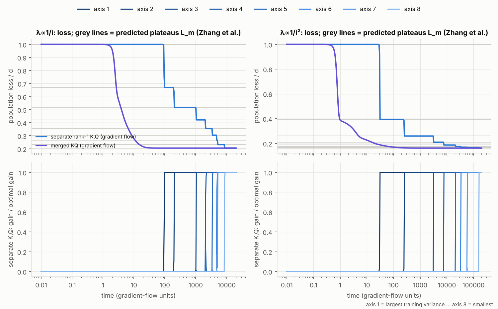
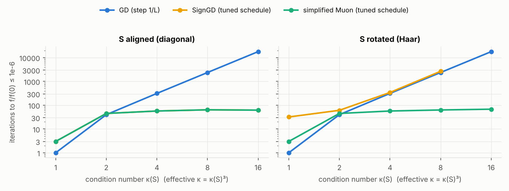
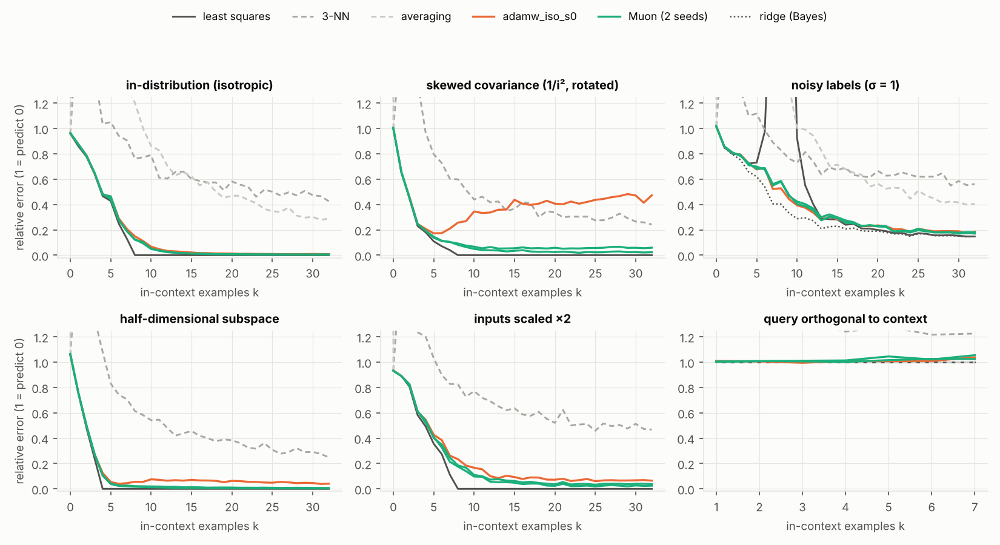
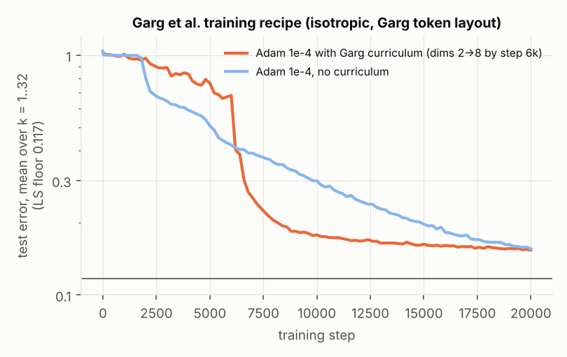
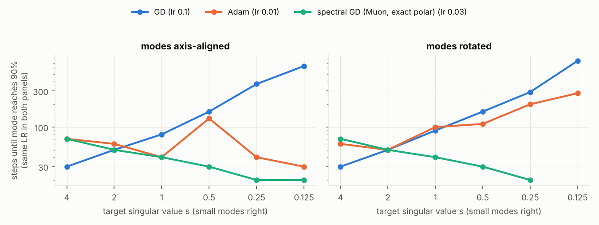

## Verification step 2 — is each independent variable tested without confounds?

**Optimizer: each optimizer is tuned per condition, not borrowed from the isotropic sweep.**
The search ran on the isotropic and λ ∝ 1/i² aligned conditions, ranked by area under the
test-error curve over a fixed budget (4k steps for AdamW and SGD, 3k for Muon). It used
selection prompts kept separate from the held-out prompts used for the final numbers.

| | Isotropic | λ ∝ 1/i² aligned (also used for rotated) |
|---|---|---|
| AdamW, LR | 1e-4 … 1e-3 (β2 0.999) and 3e-4 (β2 0.95): best **5e-4, β2 0.999** (AUC 0.596 vs 0.696 for the pilot's 3e-4); 1e-3 is much worse (0.907) and 3e-3 never escapes | 1e-4 … 1e-3 (β2 0.999) and 3e-4 … 5e-4 (β2 0.95): best **5e-4, β2 0.999** (AUC 0.255 vs 0.291 for the pilot's 3e-4). β2 = 0.95 made no real difference. |
| Muon, LR | 0.0025 … 0.02: best **0.005** (AUC 0.292), the pilot's value; 0.02 and 0.05 never escape | 0.002 … 0.01: best **0.007** (AUC 0.158, tied with 0.01; lower final error); the pilot's 0.005 scored 0.171 |
| SGD + momentum 0.9 | lr 0.01 and 0.03 (no clipping, 4k steps); 0.1 without clipping diverges by step 42; 0.1 with gradient clipping at norm 1 (10k steps); 1.0 with clipping is unstable (error 20.5 at step 2k, 8.6 at 3k, worse than predicting 0). **No setting leaves the plateau.** Momentum 0.99 was not tested. | not run (SGD never learns at all) |

The pilot's isotropic-tuned LRs were too small for both adaptive optimizers on the anisotropic
inputs. The confirmation runs use the per-condition winners.

**SGD gets a fair chance and still fails, for an identifiable reason.**
- It fails at d = 2 (4k steps), where AdamW learns within 500 steps.
- It fails with Garg et al.'s curriculum (still at error 1.000 after 5k steps).
- It fails at every LR / momentum / clipping setting above.
- The cause is measured directly. On the plateau the query/key gradient norm is 9×10⁻⁵ against a
  total gradient norm of 0.29, dominated by the read-out layer, and after 500 steps the
  query/key weights have not moved (norm 7.245 → 7.245). With one global learning rate, capped
  by the read-out's curvature, the attention circuit never starts to form. Per-coordinate
  (AdamW) or per-matrix (Muon) normalisation gives query/key learning-rate-sized steps
  regardless.
- So SGD's failure is an optimizer × architecture effect (heterogeneous gradient scales across
  blocks). It is not the input-variance effect H2 is about, and it means H2/H4 cannot be tested
  with plain SGD in this model.

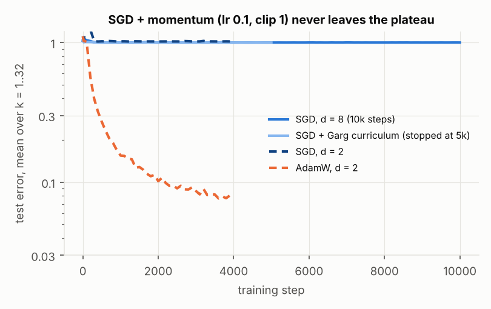

**Numerics: bf16 autocast is not a confound.** Training the same seed and config fully in fp32 gives identical plateau-escape steps (AdamW 1,900 vs 1,900; Muon 400 vs 400). The test-error curves differ by at most 0.020 (AdamW) and 0.003 (Muon) over the compared steps.

**Training length: Garg et al.'s curriculum and longer training.**
- Under Garg's own recipe (Adam 1e-4, batch 64), the curriculum reproduces their speed-up:
  error 0.204 at step 8k vs 0.356 without it.
- Every confirmation run ends with a linear learning-rate decay branch, resumed from the
  constant-LR checkpoint. End-state claims (final error, query shift, skewed-covariance
  robustness) therefore compare models after an LR decay, not a constant-LR noise floor. Even
  so, 2 of 6 AdamW 1/i² runs had still not learned the weakest axis at the end (step 3).

**Covariance alignment: the instrument can detect basis effects.** Rotating AdamW's *entire parameter space* with Xie et al.'s construction (two random permutations around a Kronecker product of three Haar rotations) is decisive. With the same seed, LR (3e-4) and data, rotated AdamW never leaves the plateau in 6k steps (validation error 0.995), while standard AdamW escapes at step 1,900. So this GPT-2 is highly sensitive to Adam's coordinate system, and the null effect of rotating only the *input covariance* (step 3) is a real negative result, not an insensitive instrument. Input rotation only reaches the read-in's input side; the hidden layers' coordinates are already random with respect to the data's principal axes.

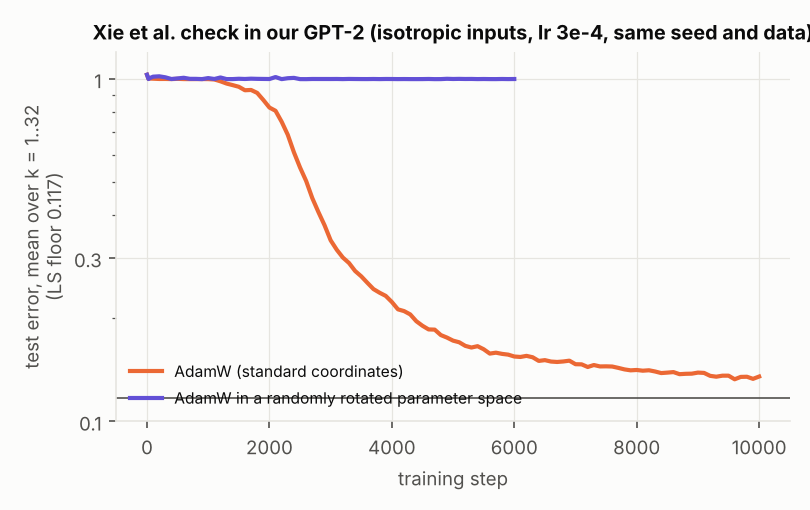

## Verification step 3 — confirmation runs (GPT-2, tuned per condition, fresh seeds, held-out prompts)

Protocol, fixed before the runs:
- **Configs.** Per-condition tuned settings from step 2: AdamW 5e-4 (β2 0.999) everywhere; Muon
  0.005 on isotropic and 0.007 on λ ∝ 1/i² inputs (aux AdamW 1e-3).
- **Seeds and prompts.** Fresh seeds 10–12 (two seeds for Muon rotated), not used in any search.
  Evaluation on a held-out prompt set (seed 30000) that no search touched.
- **Schedule.** A constant-LR phase (AdamW 8k steps, Muon 3k), then a linear learning-rate decay
  to zero (2k / 1k steps), branched from the saved checkpoint. Timing metrics come from the
  constant-LR phase; end-state metrics ("after decay") from the end of the decay.
- **Evaluation frequency.** Every 25 steps up to step 2,000, then every 100; query-shift and
  implied-weight tests every 500 / 250 steps.

Values are mean [min–max] over seeds. "Never" means not reached within the constant-LR phase.
Definitions:
- **escape:** mean error first below 0.9.
- **converged:** excess error over least squares (averaged over k = 1..32) < 0.05.
- **weakest axis:** probe error on axis 8 first below 0.5.
- **PCR/ridge:** median, over the learning window (excess error between 5% and 90% of its
  starting value), of the distance from the model's predictions to the best PCR(m) divided by
  the distance to the best ridge(λ), for k = 8..32. Below 1 is PCR-like (staircase), above 1
  ridge-like.
- **shifted-query error:** same contexts and tasks, but the query is drawn from the inverted
  spectrum (λ_i⁻¹ rescaled to trace 8), so it loads the weak axes; error at the last position.
- **weakest-axis gain:** implied-weight gain on axis 8 (1 = learned like least squares, 0 = ignored).

| covariance | optimizer | seeds | escape | converged | weakest axis | axis-8 / axis-1 time | PCR/ridge | error @32 after decay | shifted-query error after decay | weakest-axis gain after decay |
|---|---|---|---|---|---|---|---|---|---|---|
| isotropic | AdamW | 3 | 1,167 [1,075–1,300] | 5,933 [3,700–7,700] | 1,550 [1,450–1,600] | 0.98 [0.88–1.08] | 1.84 [1.76–1.90] | 0.0054 [0.0034–0.0087] | 0.0062 [0.0029–0.0097] | 1.01 [1.00–1.02] |
| isotropic | Muon | 3 | 433 [400–450] | 1,392 [1,325–1,450] | 550 [525–575] | 0.96 [0.91–1.00] | 1.72 [1.69–1.74] | 0.0013 [0.0010–0.0020] | 0.0015 [0.0011–0.0022] | 1.00 [1.00–1.00] |
| 1/i² aligned | AdamW | 3 | 150 [125–175] | 5,250 [4,900–5,600] (+1 never) | 6,350 [6,200–6,500] (+1 never) | 37 [31–43] (+1 never) | 0.76 [0.67–0.84] | 0.014 [0.003–0.034] | 0.34 [0.14–0.66] | 0.61 [−0.01–1.00] |
| 1/i² aligned | Muon | 3 | 167 [150–200] | 867 [750–975] | 900 [750–1,025] | 4.3 [3.8–4.6] | 1.17 [1.11–1.25] | 0.0011 [0.0008–0.0015] | 0.040 [0.031–0.045] | 1.01 [1.00–1.01] |
| 1/i² rotated | AdamW | 3 | 183 [175–200] | 6,200 [4,900–6,900] | 6,400 (+2 never) | 32 (+2 never) | 0.80 [0.75–0.84] | 0.010 [0.003–0.022] | 0.27 [0.09–0.52] | 0.62 [0.00–0.94] |
| 1/i² rotated | Muon | 2 | 188 [175–200] | 888 [850–925] | 925 [875–975] | 4.4 [4.3–4.4] | 1.15 [1.14–1.17] | 0.0009 [0.0009–0.0009] | 0.031 [0.030–0.031] | 1.00 [1.00–1.01] |

The full table (half-way times, constant-LR end states) is in `figures/confirm/confirm_table.md`
and the per-seed values in `figures/confirm/confirm.json`.

* **H1 — confirmed; the isotropic effect is smaller than the pilot said.**
  - Isotropic: Muon leaves the plateau at 433 [400–450] steps vs 1,167 [1,075–1,300] for AdamW
    (2.7×). It converges at 1,392 [1,325–1,450] vs 5,933 [3,700–7,700] (4.3×). The pilot said ~5×.
  - λ ∝ 1/i²: converged at 867 vs 5,250 steps aligned (6×; one AdamW seed did not converge within
    8k) and 888 vs 6,200 rotated (7×).
  - The seed ranges never overlap. Muon also ends lower after the decay (error@32 0.0013 vs
    0.0054 isotropic, 0.0011 vs 0.014 under 1/i² aligned), although AdamW trained for 10k steps
    against Muon's 4k.
  - First escape is uninformative under 1/i² (150–190 steps for both): the top axis carries most
    of the variance and is learned at once. That is why convergence and weakest-axis times are
    the H1/H2 metrics.
* **H2 (with AdamW in SGD's place) — confirmed.**
  - AdamW's weakest axis takes 1,550 → 6,350 steps (isotropic → 1/i² aligned; one seed never in
    8k), and its last-axis/first-axis time ratio grows 1.0 → 37 [31–43].
  - Muon's weakest axis takes 550 → 900 steps, and its ratio grows only 1.0 → 4.3 [3.8–4.6].
  - Plain SGD cannot be scored: it never leaves the plateau (step 2).
* **H4 (revised: AdamW, not SGD, runs the PCR staircase) — confirmed at tuned LRs on fresh seeds.**
  - AdamW under 1/i² learns the axes one at a time, in eigenvalue order, in every seed (seed 10
    aligned: steps 200, 700, 1,525, 2,400, 3,500, 4,200, 4,800, 6,200).
  - Its predictions are closer to the best PCR(m) than to any ridge for 79–96% of the learning
    window. The PCR/ridge ratio is 0.76 [0.67–0.84] aligned and 0.80 [0.75–0.84] rotated, every
    seed below 1.
  - Muon's ratio is 1.17 [1.11–1.25] aligned and 1.15 rotated, every seed above 1. It is
    PCR-like for only 12–23% of its window.
  - Muon is not literally parallel. It also adds axes in eigenvalue order (the best-fitting PCR
    rank climbs to 8), but within ~1,000 steps, and a ridge filter fits better almost throughout.
    The accurate contrast is a slow PCR staircase (AdamW) vs a compressed, ridge-like progression
    (Muon).
  - This does not depend on how checkpoints are weighted. Evaluations are 4× denser before step
    2,000, but medians taken uniformly in steps agree within 0.07 and never change a run's side
    of 1.
  - On isotropic inputs both optimizers are ridge-like (1.7–1.9), as expected when every axis
    is equivalent.
  - **"All end near least squares" holds in distribution, but not on every axis within this
    budget.** Two of six AdamW 1/i² runs finish the decay (10k steps) with implied-weight gain
    ≈ 0 on the weakest axis. One aligned seed also has gain ≈ 0 on axis 7, so it is effectively
    a PCR(6) solution. Every Muon run has gains 0.95–1.01 on all eight axes.
* **H3 — confirmed at matched in-distribution error: 1.5–2.5× lower shifted-query error for
  Muon.** Each run's trajectory is interpolated (log-linear, checkpoints 500 steps apart) to the
  step where its in-distribution query error first reaches each level. This is the proposal's
  "similar ordinary error" comparison.

  | shifted-query error when in-distribution error reaches | 0.03 | 0.01 | 0.005 |
  |---|---|---|---|
  | 1/i² aligned — AdamW | 0.47 [0.43–0.52] (2 seeds) | 0.22 [0.217–0.222] (2) | 0.15 (1) |
  | 1/i² aligned — Muon | 0.30 [0.26–0.33] | 0.10 [0.102–0.104] | 0.062 [0.059–0.063] |
  | 1/i² rotated — AdamW | 0.46 [0.37–0.55] (3) | 0.20 [0.13–0.26] (2) | 0.15 [0.10–0.20] (2) |
  | 1/i² rotated — Muon | 0.31 [0.30–0.32] | 0.12 [0.117–0.131] | 0.060 [0.0595–0.0598] |

  - Muon is lower at every level: 1.5–1.6× at 0.03, 1.6–2.2× at 0.01, 2.5× at 0.005. Within
    this budget the gap widens as training proceeds instead of closing, unlike the testbed,
    where all optimizers reach the same solution.
  - Aligned, the seed ranges never overlap. Rotated, the best AdamW seed equals Muon at 0.01
    (0.127 vs 0.117–0.131) and is 1.7× worse at 0.005.
  - AdamW seeds that never reach a level drop out of that column, so the averages flatter AdamW.
  - After the decay (not matched): 0.040 vs 0.34 aligned and 0.031 vs 0.27 rotated. AdamW's
    spread (0.09–0.66) is set by whether the seed learned the weakest axis.
  - The mechanism matches H4. At equal ordinary error, the PCR-like path has put less weight on
    the weak axes, and the inverted-spectrum query loads exactly those axes.
* **Aligned vs rotated — the null result for AdamW replicates.** It converged at 5,250
  [4,900–5,600] (+1 never) aligned vs 6,200 [4,900–6,900] rotated. Error@32 at the end of the
  constant-LR phase is 0.021 [0.009–0.042] vs 0.023 [0.010–0.039], and the PCR/ridge ratio 0.76
  vs 0.80. All differences are within seed noise. Muon converged at 867 vs 888.
* **Garg et al.'s out-of-distribution suite, on the decayed isotropic-trained models (3 seeds
  each; figure below).**
  - In distribution, both match least squares for k ≥ 16 (error ≤ 0.025 AdamW, ≤ 0.006 Muon).
    Near k = d = 8, where least squares becomes exact, Muon is closer (0.11 vs 0.15 at k = 8).
  - Noisy labels (σ = 1): both track the Bayes ridge estimator, as Garg et al. found. At k = 32
    they reach 0.16–0.19 vs 0.15. At k = 8 they reach 0.48–0.63 vs 0.40, while least squares
    blows up to 744. Here AdamW is slightly closer than Muon near k = d (0.48–0.56 vs 0.58–0.63).
  - Orthogonal queries: both ≈ 1.0, as expected. Half-dimensional subspace and inputs ×2: Muon is
    slightly lower (0.002 vs 0.011 and 0.023 vs 0.038 at k = 32).
  - **Skewed covariance (Garg's failure case):**
    - All 3 Muon models keep improving with k (error@32 0.023–0.033).
    - Only 1 of 3 AdamW models does (0.029). One gets worse with k (0.19 at k = 7 → 0.37 at
      k = 32), and one is erratic (0.93 at k = 16, 0.16 at k = 32).
    - Counting the pilot and Garg-recipe models too: 5/5 Muon-trained models are robust vs 2/6
      Adam-trained ones.
    - This is suggestive, not established: n is small, and the Adam models span three LRs and
      two token layouts. The robust AdamW seed is also the one closest to least squares in
      distribution at k = 8 (0.113 vs 0.168 and 0.179).
* **Head alignment (exploratory) — the pilot's layer-specific claims do not replicate; one
  pattern does.**
  - Across fresh seeds, the AdamW layer-3 concentration on the top axes that the pilot reported
    varies from seed to seed. On isotropic inputs only AdamW's layer 2 is fully diagonal in
    every seed; Muon's is diagonal in only some heads.
  - What holds in every run is layer 2 under 1/i². Muon's heads cover all eight axes, with a
    share that falls steadily with the eigenvalue (0.20–0.36 on axis 1, 0.04–0.05 on axis 8;
    5/5 runs). AdamW's layer-2 share on axis 8 is 0.00 in 6/6 runs.
  - The four AdamW runs that do learn the weakest axis carry it in layer 3 or 4 (axis-8 share up
    to 0.16–0.27). The two whose weakest-axis gain ends ≈ 0 have zero share on that axis in
    every layer. So the head-level picture agrees with the implied-weight gains
    (`figures/confirm/heads.txt`).

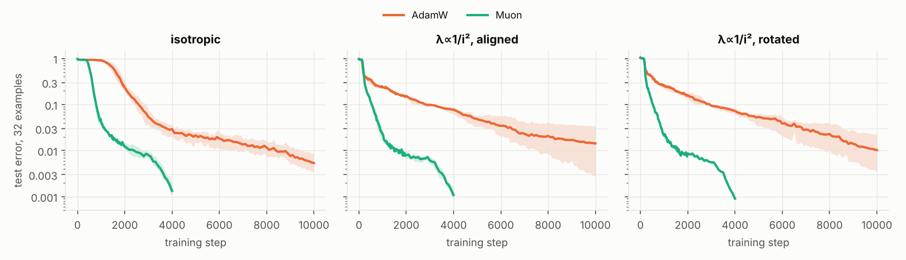
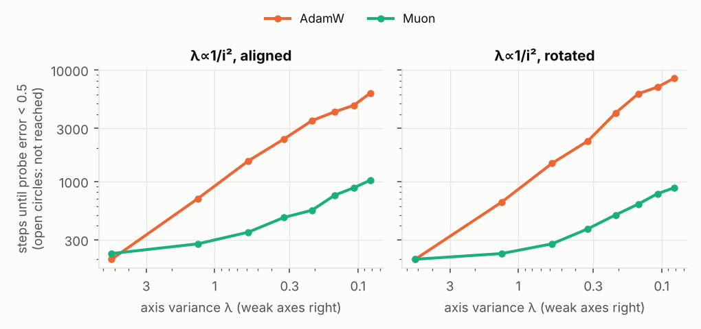
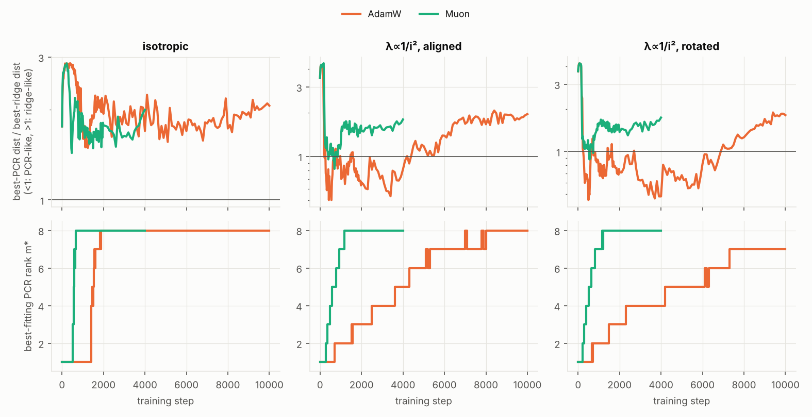
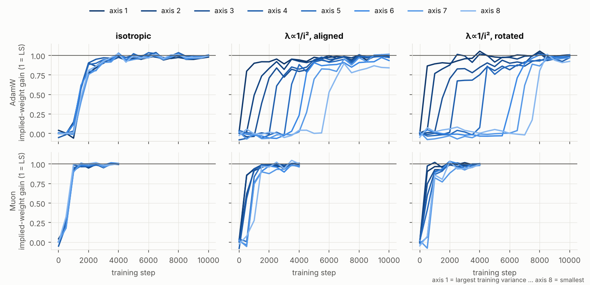
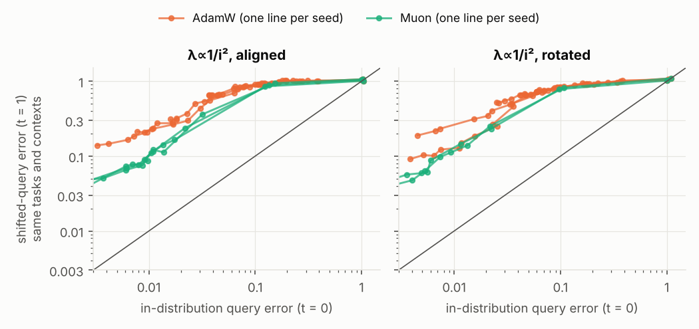
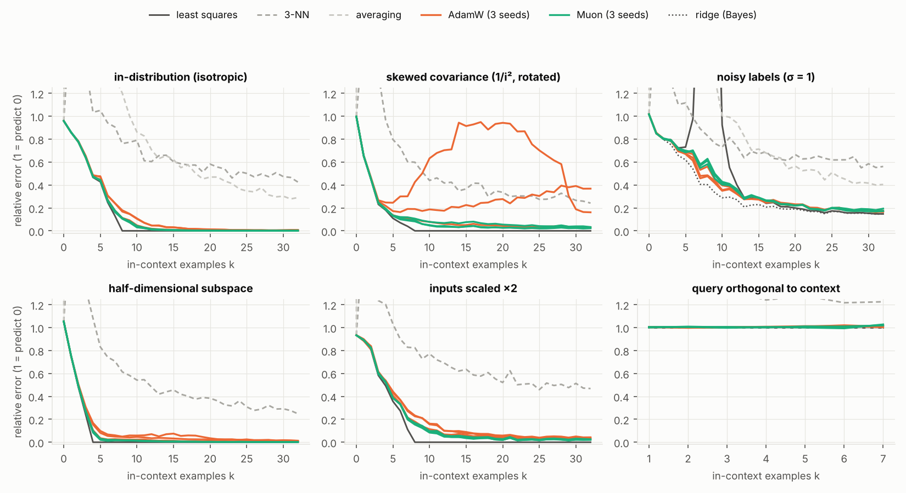

## Follow-up: four questions after verification

### 1. Why can't SGD train this GPT-2?

SGD stays on the initial plateau, where the model predicts ≈ 0, for two separate measured reasons.
Both are fixed by Muon's orthogonalised update, and the first by AdamW's per-coordinate one.

**(a) One learning rate for very different blocks.** Per-block gradients at the plateau (mean of 16
batches, `scripts/grad_blocks.py`):

| block | share of the squared gradient norm | gradient per parameter (rms) | change per step: SGD lr 0.1, momentum 0.9 (steady state, before clipping) | AdamW 5e-4 | Muon 0.005 |
|---|---|---|---|---|---|
| read-out | 63% | 3.0e-1 | **576%** of its norm | 1.0% | 1.9% |
| attention output / MLP projection | 6% / 16% | 4.0e-3 / 3.4e-3 | 56% / 48% | 7.1% / 7.1% | 6.3% / 3.1% |
| query / key | 0.0007% each | 4.4e-5 / 4.3e-5 | **0.22% / 0.21%** | 2.5% / 2.5% | 2.2% / 2.2% |

- SGD's usable learning rate is capped by the read-out. That is why lr 0.1 needs gradient
  clipping and lr 1.0 is unstable. At that cap the query/key weights move 2,600× more slowly than
  the read-out.
- AdamW and Muon move every block at 0.3–7% per step. This is Zhang et al.'s (2024) "block
  heterogeneity" explanation of why transformers need Adam, measured directly here.
- Moving the read-out, embeddings and norms to AdamW does not rescue it: SGD on the hidden
  matrices alone is still at error 1.000 after 3k steps. That was run at lr 1 and 10 with Muon's
  averaged momentum, roughly heavy-ball lr 0.1 and 1.

**(b) Within each matrix, the gradient is essentially one direction** (`scripts/grad_spectrum.py`).
- On the plateau, the top singular direction of every hidden matrix's gradient carries 85–100% of
  its squared norm (effective rank 1.1–2.8; single minibatches look the same).
- In the attention-output and MLP-projection matrices that direction is 99–100% aligned with the
  read-out, i.e. it only rescales the prediction.
- *Normalised SGD* (`--muon_orth fro`) takes exactly Muon's per-matrix step size, in the
  gradient's own direction. It is still at error 1.000 after 3k steps at lr 0.005 and 0.01, while
  Muon at lr 0.005 escapes at ~430 steps.
- So balancing step sizes across blocks is not enough. Muon works because orthogonalisation gives
  all 128 directions of each matrix the same step, including the weak ones that build the
  in-context circuit, instead of spending the step on the output-scale direction.
- Earlier checks still stand: SGD also fails at d = 2, with Garg's curriculum, and at lr 0.01–1.0
  with and without clipping.

Consequence for the proposal: the SGD arm cannot be run in this model. Normalised SGD is a useful
extra ablation ("Muon without orthogonalisation"), but it does not learn either. The clean SGD
comparison lives in the linear-attention testbed, where GD does learn.

### 2. Is "Muon is better for skewed covariance" the key takeaway?

Only in a narrower form:

> With skewed input covariance, AdamW learns in-context regression one principal direction at a
> time, so the weak directions arrive late (7× later than with Muon, and in 2 of 6 runs not at all
> within 10k steps). Muon learns them nearly together, so it converges 6–7× sooner. At equal
> in-distribution error, it is 1.5–2.5× more accurate on queries that load the weak directions.

- *Not proven.* This is evidence from one 0.8M-parameter model, d = 8, noiseless data, 3 seeds and
  ≤ 10k CPU steps. The only proofs are for one-layer linear models (Ma et al.).
- *"Better" means faster, per step, and more balanced across directions.* Both optimizers end
  near least squares in distribution. Wall-clock and compute were not compared. Robustness to a
  skewed covariance at *test* time (Garg's test) is only suggestive (5/5 vs 2/6 models).
- *Muon's advantage comes from a setting with nothing to overfit.* Every input direction carries
  real signal, tasks are fresh every prompt and labels are noiseless, so learning all directions
  at once can only help.
- The literature locates Muon's cost elsewhere. Dragutinović, Zhang & Ranganath (2026) show that
  Muon gives up gradient descent's step-by-step simplicity bias. In their shared-structure
  routing task, simplified Muon memorises instead of learning the shared rule, and on a
  spurious-feature task it peaks at lower clean accuracy. Vasudeva et al. (2025) report benefits
  of spectral updates on imbalanced data. Question 4 tests the downside.

### 3. Why did rotating the input covariance do nothing for AdamW?

Xie et al. rotate the *parameter space*. Adam's per-coordinate normalisation then acts in a basis
unrelated to the network's own coordinates, in every weight matrix. We reproduced this: AdamW in a
rotated parameter space never left the plateau in 6k steps, vs step 1,900 normally. The
proposal's R rotates the *input data*, which is a different operation:

- In a GPT-2, inputs pass through the read-in W_in before any attention or MLP weight sees them.
  Rotating x → Rx is the same as replacing W_in by W_in·diag(R, 1).
- With a Gaussian init, W_in·diag(R, 1) has exactly the same distribution as W_in. The tasks
  w ~ N(0, I) are rotation-invariant as well.
- So every layer after the read-in sees a statistically identical training problem in the aligned
  and rotated conditions. The hidden coordinates are random mixtures of the input axes either way:
  from the hidden layers' point of view the "aligned" condition is rotated too.
- Only Adam's update of the read-in itself (1,152 of ~800k parameters) can tell the conditions
  apart, so the manipulation is a near-null by construction. Garg's default uniform init is not
  exactly rotation-invariant, but close.
- In the linear-attention testbed the attention weights act on the raw input coordinates, so the
  same rotation slows Adam 2.2–6.5×, as Xie-style reasoning predicts.

**Test: an axis-preserving read-in.** Initialising the read-in as the identity (input coordinate
j → residual coordinate j, `--readin_init eye`) lets the hidden layers see the data's own basis.
That is the condition under which input alignment could matter for AdamW.

Result (λ ∝ 1/i², seed 0, held-out prompts; AdamW 5e-4 for 6k steps, Muon 0.007 for 3k steps, the
tuned settings):

| optimizer | read-in | covariance | steps at which axes 1–8 are learned (probe error < 0.5) | converged | final error@32 |
|---|---|---|---|---|---|
| AdamW | identity | aligned | 425, 1,125, 1,700, 2,400, 3,200, 5,200, –, – | 5,500 | 0.043 |
| AdamW | identity | rotated | 225, 675, 1,275, 1,850, 3,400, 5,400, –, – | not within 6k | 0.048 |
| AdamW | Gaussian (confirmation, 3 seeds) | aligned | e.g. 200 … 6,200; the 6th axis at 4,200–6,700 | 4,900–5,600 (+1 never) | 0.009–0.042 at 8k |
| Muon | identity | aligned | 200, 225, 300, 400, 450, 625, 725, 900 | 775 | 0.0058 |
| Muon | identity | rotated | 225, 275, 325, 400, 550, 600, 750, 900 | 825 | 0.0059 |
| Muon | Gaussian (confirmation, 3 seeds) | aligned | the 8th axis at 750–1,025 | 750–975 | 0.005–0.007 |

Even when the data's axes reach every hidden layer, aligning the covariance gives AdamW no
advantage. The early axes even come sooner when rotated, and the differences sit well inside the
seed spread. Muon, the control, is unaffected too, and its identity-read-in runs match its
Gaussian-read-in runs. This is one seed per condition, so it rules out a large effect, not a
small one.

So the null does not come only from the random read-in. The coordinate structure Adam exploits
(Xie et al.) is the alignment of the *loss in parameter space* with the parameter coordinates. In
a multi-layer transformer, the in-context circuit is built from products such as W_Qᵀ W_K whose
other side is random at initialisation, so input-axis alignment does not make the curvature
coordinate-aligned for any single weight matrix. In the one-layer testbed, by contrast, the
trained matrix acts directly on the input coordinates, and alignment does matter (2.2–6.5×).
Practical consequence: drop the aligned-vs-rotated arm from the GPT-2 study, or keep it only as a
negative control.

### 4. Is in-context learning transient, and is Muon the most transient?

Transience cannot happen in the main setup: a fresh task in every prompt leaves nothing to
memorise. It needs a memorisable alternative (Singh et al. 2023), here a finite pool of M training
tasks (Raventós et al. 2023). The model can then either keep doing in-context regression, which
generalises, or memorise the pool, which does not.

**Design** (`--n_tasks M --noise 0.5`, `icl/transience.py`, `scripts/analyze_transience.py`):
- *Setting.* Isotropic x, d = 8, prompts of 17 points (scored on predictions from 1–16
  examples), label noise σ² = 0.25, the same GPT-2. AdamW 5e-4 vs Muon 0.005 (their tuned LRs),
  batch 64, constant LR, no weight decay for either. Both optimizers see the same task pool.
- *Pool sizes* M ∈ {16, 32, 64, 256}. These are smaller than first planned (64–4,096), because
  at M = 256 neither optimizer memorises within the budget.
- *Budget.* Seed 0 at every M for 16k steps. Seeds 1–2 were added at M = 16 and 32. Muon got
  fewer steps (5k and 12k vs AdamW's 10k and 32k), since it reaches each training loss 2–3×
  sooner. AdamW seed 0 at M = 32 was extended to 32k steps so that its fade time is not cut off.
- *References.* Two Bayes-optimal predictors are computed exactly for every evaluation prompt:
  **ridge** (posterior mean under the true prior w ~ N(0, I): in-context learning proper) and
  **dMMSE** (posterior mean when w is known to be one of the M pool tasks: memorisation).
- *ICL score* on unseen tasks: s = (E_dMMSE − E_model)/(E_dMMSE − E_ridge). 1 = generalises like
  ridge, 0 = no better than memorising.
- *Memorisation score* on pool tasks: m = (E_ridge − E_model)/(E_ridge − E_dMMSE). 1 = identifies
  pool tasks like dMMSE, 0 = no better than ridge on them. The pool error is the training loss minus
  the label-noise variance, so m is also a normalised training loss.
- *Transient ridge* (Carroll et al. 2025): s rises toward 1, then falls toward 0 while m rises.
- *Hypothesis as stated in advance.* If Muon's weaker simplicity bias makes ICL more transient,
  Muon's ICL score should fade earlier. It should do so **relative to its own emergence time**,
  not just in raw steps, since Muon is faster at everything. It should also fade at larger M than
  AdamW's. Emergence is the first checkpoint with s ≥ 0.5; fading is the first checkpoint after
  the peak with s < 0.5.
- *Counterpoint.* Small-batch noise has been reported to restore part of Muon's sequential
  learning (arXiv 2610.16868). Our Muon at batch 64 still adds input directions in eigenvalue
  order (step 3).

**Results.** There were 3 seeds at M = 16 and 32, and 1 seed at M = 64 and 256. The numbers are in
`figures/transience/transience.json`.

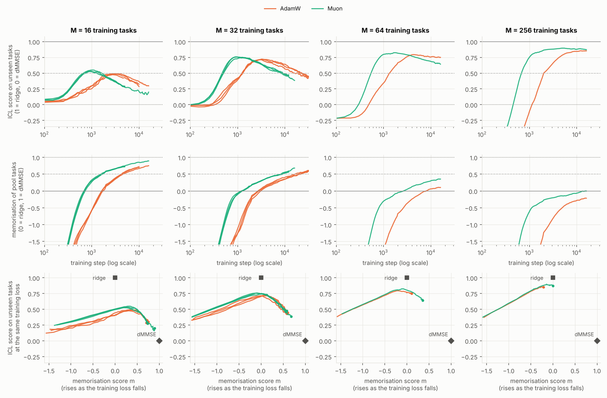

*Top: ICL score on unseen tasks against training step (log scale). Middle: memorisation score on
the training tasks. Bottom: the same runs with the two scores plotted against each other, i.e. the
ICL score at each level of training loss. One line per seed, smoothed over 5 checkpoints.*

Both optimizers show transient in-context learning at M = 16 and 32. The ICL score rises and
peaks, then falls as the model starts identifying the training tasks from memory. This is the
"transient ridge" of Carroll et al. (2025). At M ≥ 64, ICL persists within 16k steps for both,
although Muon's score is already declining at M = 64.

| M | optimizer | ICL emerges (s ≥ 0.5) | peak s | ICL fades (s < 0.5) | memorised (m ≥ 0.5) | fade / emerge |
|---|---|---|---|---|---|---|
| 16 | AdamW | 3,250–3,500 (2 of 3; one peaks at 0.49) | 0.49–0.52 | 3,500–3,750 | 4,000–5,000 | 1.1, 1.1 |
| 16 | Muon | 700–750 | 0.53–0.57 | 1,250–1,600 | 1,550–1,700 | 1.7–2.3 |
| 32 | AdamW | 1,250–1,300 | 0.73–0.74 | 15,250–21,250 | 16,250–20,750 | 11.7–17.0 (median 16.0) |
| 32 | Muon | 500 | 0.76–0.77 | 7,750–8,500 | 7,250–8,500 | 15.5–17.0 (median 15.5) |
| 64 | AdamW | 1,350 | 0.80 | not within 16k (s = 0.74) | not within 16k (m = 0.10) | > 11.9 |
| 64 | Muon | 550 | 0.83 | not within 16k (s = 0.63) | not within 16k (m = 0.35) | > 29.1 |
| 256 | AdamW | 2,250 | 0.86 | no (s = 0.85 at 16k) | no (m = −0.23) | > 7.1 |
| 256 | Muon | 700 | 0.90 | no (s = 0.86 at 16k) | no (m = −0.02) | > 22.9 |

*Training steps, as ranges over seeds; the last column is the pre-registered criterion.*

1. **Per step, Muon is more transient.** At M = 32 its ICL fades at 7,750–8,500 steps, against
   15,250–21,250 for AdamW, and it memorises 2.4× sooner. Under the 16k-step budget first used for
   seed 0, only Muon's ICL faded at M = 32.
2. **That is Muon's faster clock, not a different trajectory.** Muon reaches every landmark sooner
   by about the same factor. It hits the ICL landmarks (s ≥ 0.25, s ≥ 0.5) 1.9–3.0× sooner, and the
   memorisation landmarks (m ≥ 0, 0.25, 0.5) 2.2–3.0× sooner (median over seeds, smoothed curves).
   On the log-step axes, Muon's curves are AdamW's shifted left.
3. **The pre-registered criterion does not support the hypothesis.**
   - Relative to its own emergence time, Muon's ICL lasts as long as AdamW's at M = 32
     (fade/emerge 15.5–17.0 vs 11.7–17.0), and longer at M = 16 (1.7–2.3 vs 1.1).
   - The M = 16 ratio is fragile, because there ICL barely crosses the 0.5 threshold (peaks
     0.49–0.57).
   - Neither optimizer fades at M = 64 within 16k steps, so "Muon fades at larger M" is not
     observed either.
4. **At the same training loss, Muon generalises at least as well.** This analysis was added after
   seeing seed 0. Because m is a normalised training loss, comparing the ICL score at equal m
   compares the optimizers when they fit the training distribution equally well, whatever their
   speed.

| M | m = −0.5 | m = 0 | m = 0.25 | m = 0.5 |
|---|---|---|---|---|
| 16 | 0.30 vs **0.40** | 0.42 vs **0.50** | 0.48 vs **0.53** | 0.46 vs 0.48 |
| 32 | 0.60 vs **0.67** | 0.71 vs **0.75** | 0.66 vs 0.67 | 0.51 vs 0.51 |
| 64 (1 seed) | 0.72 vs 0.73 | 0.77 vs 0.80 | – | – |
| 256 (1 seed) | 0.78 vs 0.79 | – | – | – |

*ICL score on unseen tasks, AdamW vs Muon (mean over seeds), at the first moment each run
reaches a given memorisation score. Bold: seed ranges do not overlap. m = 0 is where the model
first beats ridge on the training tasks. "–": not reached by both optimizers.*

   - Before memorisation takes over (m ≤ 0), Muon's ICL score is 0.04–0.10 higher at M = 16
     and 32, with separate seed ranges. At M = 64 and 256 it is 0.01–0.04 higher (one seed).
   - Put the other way: at the same training loss, AdamW generalises worse to new tasks. More of its
     progress comes from what is specific to the training tasks.
   - Once memorisation dominates (m ≥ 0.5), the two coincide.
   - Muon's peak ICL score is also higher at every M: 0.53–0.57 vs 0.49–0.52 at M = 16, and
     0.76–0.77 vs 0.73–0.74 at M = 32.
   - In the bottom row of the figure, the optimizers trace nearly the same path from ridge towards
     dMMSE; Muon travels it faster.
   - The comparison barely depends on smoothing: windows of 1, 3 or 5 checkpoints move it by
     ≤ 0.02 (checked on seed 0).

**Verdict: the hypothesis is not supported here.**
- Muon's in-context learning fades sooner per step, because Muon learns everything about 2.5×
  faster.
- It is not more transient. Relative to its own clock it lasts as long as AdamW's. At the same
  training loss it generalises at least as well, and better early on.
- The prediction that weaker simplicity bias makes Muon memorise sooner does not show up.

Possible reasons, none tested here:
- Practical Muon keeps much of the learning order. In this GPT-2 it still adds input directions in
  eigenvalue order, only faster (step 3). Dragutinović et al. studied a simplified Muon.
- Minibatch noise (batch 64) may restore part of the sequential behaviour (arXiv 2610.16868).
- Both optimizers follow the same path, so the switch from ridge to dMMSE looks like a property of
  the training distribution, with the optimizer setting only the speed along it. That fits the
  loss–complexity account of transience (Carroll et al. 2025; Wurgaft et al. 2025): the memorising
  solution takes over once its lower loss outweighs its complexity.

**Consequences for the study.**
- Compare transience at matched training loss, or on a log-step axis, not at a fixed step count.
  With a fixed budget, Muon looks more transient than it is.
- For persistent ICL with Muon, use larger pools (M ≥ 256 here) or stop earlier. At M = 32 Muon's
  ICL window (s ≥ 0.5) lasts about 7k steps, against 14k–20k for AdamW.
- SGD cannot take part in this test in this GPT-2 (question 1).

**Limitations.**
- One LR per optimizer (the tuned values from the noiseless study), a constant LR, and d = 8.
- No weight decay. Singh et al. (2023) found that L2 regularisation can make ICL persist, so weight
  decay could interact with the optimizer.
- Three seeds at M = 16 and 32, but only one at M = 64 and 256.
- "Muon" includes AdamW at lr 1e-3 on the embeddings, read-in/out and norms, as in the main study.

## A better experiment, given the negative results

Three of the proposal's manipulations came back null or untestable in the GPT-2:
- SGD never trains it.
- Rotating the input covariance does nothing for AdamW.
- Muon is not more transient than AdamW at matched training loss.

This section asks why, using a literature review (2023–2026; papers read in full where cited as such) and pilot runs. It then recommends a redesign in which each of these becomes a measured boundary condition instead of a dead end. Pilot code and logs:
- `scripts/noise_sweep_linattn.py`, `scripts/ladder_sweep.py`, `scripts/analyze_noise.py`, `icl/lintf.py`;
- `runs/linattn/noise_sweep*.json`, `runs/noise/`, `runs/concat/`, `runs/ladder/`, `runs/zipf/`.
Figures are in `figures/noise/`.

### What the negative results have in common

**1. SGD: the GPT-2 is outside the regime where SGD is known to train.**
- No paper the review found trains Garg et al.'s GPT-2 on in-context regression with SGD. The models trained with GD or SGD in the ICL theory literature are linear or one-layer attention models, mostly on concatenated (x, y) tokens (e.g. Zhang, Frei & Bartlett 2023; Huang, Cheng & Liang 2023; Ahn et al. 2023).
- Our measured causes match the literature:
  - Block heterogeneity (Zhang et al. 2024, arXiv 2402.16788).
  - Plateau gradients that are nearly rank-1 along the read-out direction. A scalar read-out sends one direction back into the residual stream at every token.
  - Interleaved x and y tokens need a two-layer copy circuit before any regression can happen (von Oswald et al. 2023, arXiv 2212.07677).
- Pilot: concatenated tokens [x_i, y_i] make AdamW about 10× faster (error 0.24 by step 400 on isotropic inputs). SGD still stays at error 1.00 for 3,000 steps at lr 0.1 and 0.3.
- **Adding a larger init fixes it.** Every hidden matrix gets std 1/√128 instead of GPT-2's 0.02 and 0.02/√8, which shortens the chain of tiny matrices the gradient passes through (Noci et al. 2022, arXiv 2206.03126). SGD (lr 0.1, momentum 0.9, clip 1) then reaches error 0.25 by step 600 and 0.16 by step 3,000 on isotropic inputs. AdamW with the same init gets 0.15.
- **Both changes are needed.** The larger init alone, with separate x and y tokens, leaves SGD at error 0.96 after 3,000 steps.

**2. Rotation: rotating x is the one kind of rotation Adam tolerates in transformers.**
- x → Rx changes the read-in W_in to W_in·diag(R, 1). That rotates the weights *leading to each read-in neuron* among themselves, which Zhang, Maes et al. (2024, arXiv 2410.19964, full text) call an *output-wise* rotation. In their words: "Performance is preserved under output-wise rotations but progressively worsens with input-wise, layer-wise, and global rotations" (GPT-2: 16% slower under a global rotation; ViT: 96%).
- Adam-mini (arXiv 2406.16793) makes the same point another way: one learning rate per head or output neuron matches AdamW. So the within-neuron adaptivity an input rotation could touch is not what Adam relies on in a transformer.
- Pilot: noise does not explain the GPT-2 null. At batch 256 (4× ours), AdamW learns axes 1–5 at 125, 250, 500, 1,000 and – steps aligned, against 125, 275, 575, 975 and 1,500 rotated. Its spectral exponent over axes 1–4 is 0.73 vs 0.74.
- In the one-layer testbed, where the rotation does reach the attention weights directly, Adam's penalty *grows* with batch size. This is the sign-descent limit (Kunstner et al. 2023, arXiv 2304.13960; Balles & Hennig 2018).

**3. Simplicity bias: gradient noise is the dial, and batch 64 was already near its low-noise end.**
- Spectral descent learns all directions at once only without noise. Small-batch noise restores sequential learning, because when the gradient is small relative to the noise, the expected orthogonalised update becomes proportional to the gradient (Jacobs & Burkholz 2026, arXiv 2610.16868, full text).
- Even without noise, spectral flow on linear attention spreads learning times by (λ_j/λ̂_j)^(1/3) (Dragutinović et al. 2026, arXiv 2603.00742, Thm C.3). For our spectrum that is about 2.6–4× at N = 32, i.e. a floor of β ≈ 0.25–0.33.
- Pilot results for β, the spectral learning exponent (time to learn eigen-direction j ∝ λ_j^(−β)):

| Muon, λ ∝ 1/i² | batch 16 | 64 | 256 | 1,024 |
|---|---|---|---|---|
| testbed, Newton–Schulz, momentum 0.95 | 0.90 | 0.68 | 0.56 | 0.37 |
| testbed, exact polar, momentum 0.95 | 0.69 | 0.64 | 0.41 | 0.25 |
| testbed, Newton–Schulz, no momentum | 0.84 | 0.78 | 0.66 | 0.43 |
| GPT-2, Newton–Schulz, momentum 0.95 | 0.45 | 0.33–0.38 (3 seeds) | 0.25 | – |

*Testbed: 3 seeds at a per-cell tuned LR. GPT-2 at batch 16 and 256: one seed each. For reference, AdamW in the GPT-2 has β ≈ 0.8–1.1, and GD in the testbed β ≈ 1.3–1.7 on the axes it learns.*

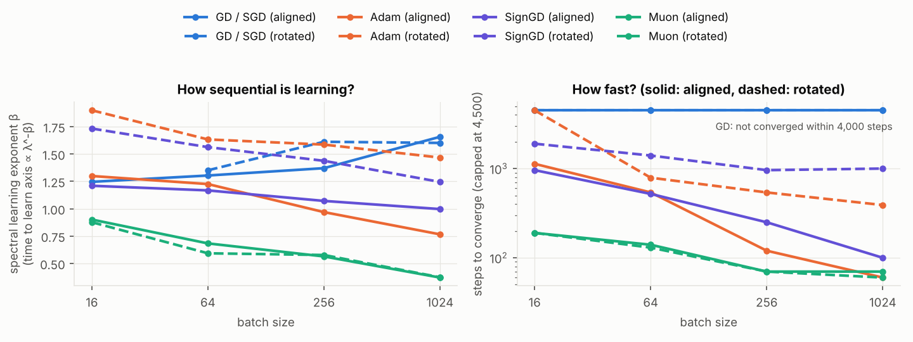

*One-layer testbed, λ ∝ 1/i², 3 seeds per cell at a tuned LR. Left: β for each optimizer, aligned (solid) and rotated (dashed). Right: steps to converge. Adam's and SignGD's rotation penalty (dashed above solid) grows with batch size; Muon is rotation-invariant and becomes more sequential as the batch shrinks.*

- Noise raises β in every Muon variant. Momentum and exact orthogonalisation lower it.
- The GPT-2 at batch 64 (32 predictions per prompt, momentum 0.95) already sits close to the noise-free floor. So the transience test ran where Muon's simplicity bias should be *weakest*, and Muon was still not more transient. Noise cannot explain that null away.

**4. The model ladder: where SGD trains and where Adam's alignment advantage survives.**
- Multi-layer linear transformers on raw concatenated tokens (`icl/lintf.py`; separate per-head Q, K, V, O, no softmax, MLP or LayerNorm).
- Setting: λ ∝ 1/i², batch 256, 2,000 steps, a 3-point LR sweep per cell and 2 seeds.

| model | SGD: steps to loss 0.25 | SGD β (aligned / rotated) | Adam β | Muon β |
|---|---|---|---|---|
| 1 layer, raw tokens | 400 | 0.79 / 0.77 | **0.37 / 0.68** | 0.29 / 0.37 |
| 2 layers, raw tokens | 200 | 0.77 / 0.84 | 0.67 / 0.69 | 0.53 / 0.60 |
| 4 layers, raw tokens | 200 | 0.80 / 0.84 | 0.75 / 0.80 | 0.44 / 0.43 |
| 2 layers + learned 32-wide read-in | **never** (loss 0.45 / 1.07) | – | 0.68 / 0.89 | 0.55 / 0.58 |

- **SGD trains multi-layer linear transformers on raw tokens at every depth**, as Ahn et al. (2023, arXiv 2310.01082) report. It fails as soon as a learned read-in into a wider stream is added. The read-in and width are part of SGD's GPT-2 problem.
- **Adam's alignment advantage is clear only in the one-layer raw-token model**: β 0.37 aligned vs 0.68 rotated, and loss 0.25 reached at step 100 vs 250. At depth 2 and 4, and with a read-in, it is within noise. The GPT-2 null is the end point of this trend.
- **Muon has the lowest β at every depth.**
- *Caveats.* This was one quick pass.
  - Adam at depths 2 and 4, and SGD at depth 4 (aligned), diverged late in training at the selected LR. Their times and β come from before the divergence.
  - SGD and Muon are rotation-equivariant, so their aligned-vs-rotated differences should be zero. Those differences (up to 2× in timing, 0.1 in β) are this pilot's noise floor.
  - A full version needs ≥ 4 seeds, finer logging and an LR decay.

**5. A Zipfian task pool (cheap version) shows only a small, early effect.**
- Setting: 64 training tasks with frequencies ∝ 1/k (Chan et al. 2022), label noise 0.5, one seed each.
- Memorisation is scored separately on the most frequent eighth of the tasks and the least frequent half, at matched training loss:

| matched training loss (m) | AdamW: rare − frequent | Muon: rare − frequent | ICL score on unseen tasks (AdamW / Muon) |
|---|---|---|---|
| 0 | −2.63 | −2.18 | 0.43 / 0.53 |
| 0.25 | −1.95 | −1.72 | 0.60 / 0.67 |
| 0.5 | −1.42 | −1.41 | 0.71 / 0.73 |

- Muon is slightly more balanced across task frequencies early on, the direction Wang et al. (2025, arXiv 2509.26030) predict. It also does more ICL, as in the uniform-pool test. The gap closes by m = 0.5.
- In this version the task enters only through the context, so nothing reaches Adam's per-row adaptivity. That adaptivity is the mechanism by which heavy-tailed data separates Adam from GD (Kunstner et al. 2024, arXiv 2402.19449).
- If this direction is pursued, give each task an identity token whose embedding row the model learns. The rare tasks then live in rarely updated rows. A fixed random rotation of that table is invisible to SGD and Muon but not to Adam, which also checks the code.

**6. The redesigned GPT-2: all three optimizers train, and their order is the one the proposal predicted.**
- Setting: concatenated tokens and hidden init 1/√128; λ ∝ 1/i² aligned, batch 64, the study's tuned LRs (SGD 0.1 with clipping); seeds 10 and 11.

| optimizer | steps at which axes 1–8 are learned (seed 10; seed 11) | β | weakest ÷ strongest | converged | final error |
|---|---|---|---|---|---|
| SGD | 25, 50, 150, 275, 425, 850, 1,600, 2,100; 25, 100, 150, 225, 350, 1,450, 1,975, 2,500 | **1.11, 1.11** | 84×, 100× | 2,300, 2,500 | 0.071, 0.077 |
| AdamW | 50, 75, 125, 200, 325, 600, 950, 1,250; 50, 75, 175, 250, 400, 825, 1,475, 2,000 | **0.80, 0.91** | 25×, 40× | 1,425, 2,000 | 0.066, 0.072 |
| Muon | 50, 75, 100, 150, 200, 250, 325, 400; 50, 75, 100, 150, 200, 325, 450, 600 | **0.51, 0.60** | 8×, 12× | 450, 575 | 0.065, 0.064 |

- SGD is the most sequential and Muon the least, with AdamW between, in both seeds and with no overlap.
- All three end at similar error, and everything learns faster than in the original layout: AdamW converges at 1,425 vs ~5,000 steps.
- One caveat. The PCR-vs-ridge path ratio, which separated AdamW (PCR-like) from Muon (ridge-like) in the original model, reads 1.28–1.38 (ridge-like) for all three here. The estimator-shape part of H4 needs re-checking in this model.

### Recommended experiment

**Question.** How do an optimizer's geometry and the gradient noise set the order in which a transformer learns the directions of an in-context regression task? And does that order predict out-of-distribution behaviour?
- The geometries are Euclidean (SGD), coordinate-wise (AdamW) and spectral (Muon).
- This keeps the proposal's core (H1, H2, H4: who learns which directions, when) and fixes each failure:
  - SGD now trains.
  - The factor that replaces rotation, batch size, demonstrably moves the optimizers.
  - The simplicity-bias question becomes a dose-response measurement instead of a transience test.

**Model.** The study's GPT-2 (4 layers, 4 heads, width 128) with concatenated (x_i, y_i) context tokens, which keep a prediction at every prefix length, and hidden matrices initialised at std 1/√width. Optionally add the one-layer linear-attention testbed and 2–4-layer linear transformers as bridges to theory.

**Factors.**

| factor | levels | why |
|---|---|---|
| optimizer | SGD (momentum 0.9, clip 1), AdamW, Muon (Newton–Schulz, momentum 0.95). Controls: normalised SGD; Muon with exact polar or no momentum | the proposal's three geometries; normalised SGD is Muon without the orthogonalisation; exact polar is Muon as the theory has it; no momentum removes momentum's noise averaging |
| batch size (gradient noise) | 16, 64, 256 (1,024 on a GPU) | moves Muon's β from 0.45 to 0.25 in the original GPT-2 and from 0.90 to 0.37 in the testbed |
| input spectrum | λ ∝ i^−p, p = 0, 1, 2 | the range of λ that β is fitted over; p = 0 is the control (all directions equal) |
| seeds | ≥ 3 per cell, 5 for AdamW | AdamW's weak-axis times vary most across seeds |

**Readouts.**
1. β: the slope of log(time to learn eigen-direction j) against log(1/λ_j), from probe prompts (`run_metrics` already computes the axis times).
2. The weakest ÷ strongest learning-time ratio, and the final per-axis gains.
3. At matched in-distribution error: error on queries that load the weak directions (the proposal's H3), and Garg's skewed-covariance test.

**Hypotheses, with what the pilots already show.**
- **R1, geometry orders β.** At every batch size, β_SGD > β_AdamW > β_Muon.
  - Redesigned-GPT-2 pilot, two seeds: 1.11 > 0.80–0.91 > 0.51–0.60.
  - Theory: GD's plateau law gives time ∝ λ⁻² in linear attention (1.3–2 in our testbed). Noise-free spectral flow has a floor of β ≈ 0.25–0.33 for this spectrum.
- **R2, noise dial.** β_Muon falls toward that floor as the batch grows; β_SGD barely moves; β_AdamW lies between.
  - Original-GPT-2 pilot: Muon 0.45 → 0.33–0.38 → 0.25 for batch 16 → 64 → 256 (one seed at 16 and 256). AdamW ≈ 0.9 → 0.73 over axes 1–4 for batch 64 → 256.
  - Still to be run in the redesigned model.
- **R3, does the order matter?** At matched in-distribution error, weak-direction query error and Garg's skewed-covariance failure should track β: worst for SGD, best for Muon, and worse for Muon at small batch than at large batch. This is the testable form of "simplicity bias costs or buys something".
- **R4, negative control.** Input rotation should change nothing in the GPT-2 (pilot: AdamW null at batch 64 and 256). Keep one rotated cell per optimizer as a check, not as a hypothesis.

**Drop or demote:** the aligned-vs-rotated arm as a hypothesis, and transience as the main question. Transience was null in the regime where Muon's simplicity bias is weakest.

**Cost.**
- On CPU a GPT-2 run takes about 10–30 minutes at batch 64; batch 256 is about 4× slower per step.
- The core grid is 3 optimizers × 3 batch sizes × 3 spectra × 3 seeds = 81 runs. That is roughly a day on a 4-core machine, or a few hours on one GPU.
- The linear bridge models take minutes per run.

**Second-choice designs, ranked.**
1. *Adam's basis dependence, measured directly.* Rotate AdamW's parameter coordinates at increasing scope: output-wise, input-wise, layer-wise, global (Zhang, Maes et al. 2024). Compare with Adam-mini.
   - Prediction: output-wise ≈ null, which is what input rotation amounts to; global ≫ input-wise.
   - About 8 CPU-hours.
2. *Zipfian task identities through a learned embedding table* (point 5 above). This reaches Adam's per-row adaptivity, and Muon is predicted to be more balanced across task frequencies. About 15 CPU-hours.
3. *Transience at the two ends of the noise dial* (batch 16 vs ≥ 256) with finite task pools. This is a small-effect test of the original hypothesis; our data predict no difference at batch ≥ 64.

**Novelty.** The literature review found none of the following published:
- a study of Muon in ICL beyond one layer;
- a test of how batch size changes the order in which optimizers learn ICL directions;
- a clean test of Adam's rotation penalty against batch size.

The recommended study would supply all three.

## The theory testbed (one-layer linear attention) supports H1, H2 and H4

Same data as the proposal (d = 8, N = 32, noiseless, the five covariances). Model: Zhang et al.'s
8-head linear attention, either **separate rank-1 K and Q per head** (the setting of their
staircase) or **merged K·Q**, small init. Each optimizer got its own 5-point LR sweep per
condition (selection: area under the loss curve), then 3 seeds at the selected LR, 4,000 steps,
batch 1,024. The loss is the exact population loss; the optimum is one-step preconditioned GD
(trΛ-shrunk), so "converged" means within 5% of that optimum.

**Steps to converge (excess loss < 5%), separate K/Q, median of 3 seeds**

| | iso | 1/i aligned | 1/i rotated | 1/i² aligned | 1/i² rotated |
|---|---|---|---|---|---|
| GD | 460 | 1,590 | 1,350 | > 4,000 | > 4,000 |
| Adam | 90 | 110 | 240 | 60 | 390 |
| SignGD | 110 | 140 | 350 | 100 | 1,000 |
| Muon (NS5) | 70 | 70 | 70 | 70 | 60 |
| Muon (exact polar) | 60 | 60 | 60 | 50 | 60 |

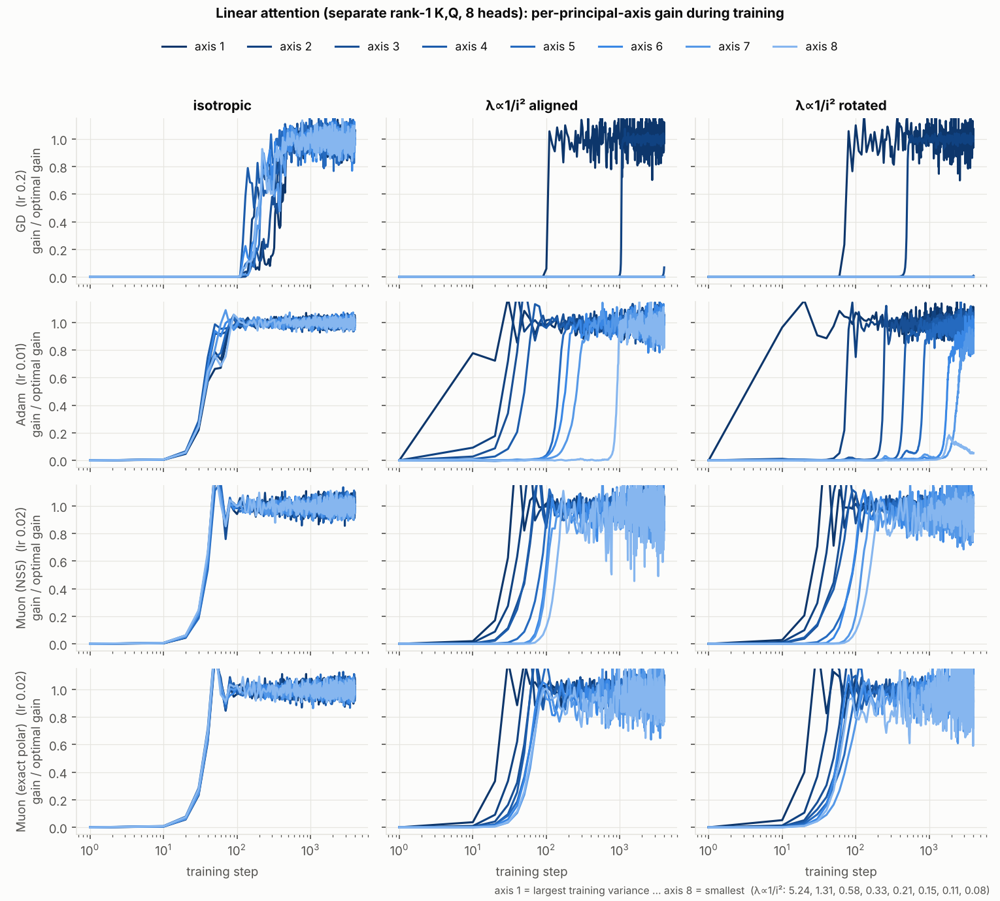
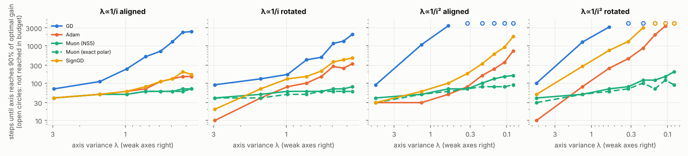

**Robustness check (added in verification).** I reran every optimizer on the *exact* population
gradient (no sampling noise), over an 8-point LR grid, at two initialization scales (1e-3 and
1e-2). The table gives steps to converge at each optimizer's best LR (both inits agree within a
factor of 1.5):

| λ ∝ 1/i², aligned → rotated | separate K, Q | merged K·Q |
|---|---|---|
| GD | > 3,000 → > 3,000 | 330 → 330 |
| Adam | 20 → 170–180 | 20 → 70 |
| SignGD | 30 → ≈1,450 | 30–40 → 610–630 |
| Muon (NS5) | 10–20 → 30 | 10–20 → 20 |
| Muon (exact polar) | 10 → 10 | 10–20 → 10 |

So the orderings below do not depend on minibatch noise, the LR picked, or the init scale.
Muon and GD are rotation-invariant, Adam and SignGD are not, and GD is slowest. With exact
gradients the normalised optimizers converge in tens of steps at the top of the grid, so only
the *relative* comparisons are meaningful here.

* **H1 (Muon earlier): supported.** Muon is the fastest in every anisotropic condition.
  On isotropic inputs Adam is about as fast (90 vs 70 steps).
* **H2 (imbalance slows SGD more than Muon): supported, strongly.** GD's time to learn an axis
  scales roughly as λ⁻², matching Zhang et al.'s plateau law. Under λ ∝ 1/i², GD has not learned
  axes 4–8 after 4,000 steps. Muon's convergence time is flat across all five covariances, the
  condition-number-free behaviour Ma et al. prove.
* **Alignment (the proposal's R manipulation): Adam and SignGD depend on it; GD and Muon do not.**
  Rotating the covariance slows Adam 2.2× (1/i) to 6.5× (1/i²), and SignGD 2.5–10×. GD and Muon
  are unchanged, as rotation equivariance requires. This is the testbed analogue of Xie et al.
  When aligned, Adam is nearly as fast as Muon, as Ma et al.'s SignGD = Muon identity predicts.
* **H4 (SGD → PCR staircase, Muon → ridge-like): supported, but only for rank-1 separate heads.**
  - GD learns one principal axis at a time, in eigenvalue order. Its gain profile along the
    learning path fits a PCR step better than a ridge curve in every anisotropic condition
    (path-averaged residual 0.01–0.20 vs 0.42–0.77).
  - Exact-polar Muon learns all axes nearly together and is ridge-shaped (0.44 vs 0.10 at 1/i²
    aligned). NS5-Muon is in between at 1/i² (0.25 vs 0.31). Its quintic iteration
    under-amplifies the smallest gradient singular values, so the weakest axis takes 160 steps
    instead of 90.
  - Adam and SignGD are PCR-like under 1/i² even when aligned, i.e. closer to SGD than to Muon,
    which H4 does not anticipate.
  - **With merged K·Q the staircase disappears for every optimizer, GD included.** GD's profile
    becomes ridge-like (0.34 vs 0.20 at 1/i aligned), with one abrupt drop, as Zhang et al.
    predict. So the PCR path is a property of the *parametrization* as much as of the optimizer.
    That matters for a GPT-2 whose heads have dimension 32 ≥ d.

    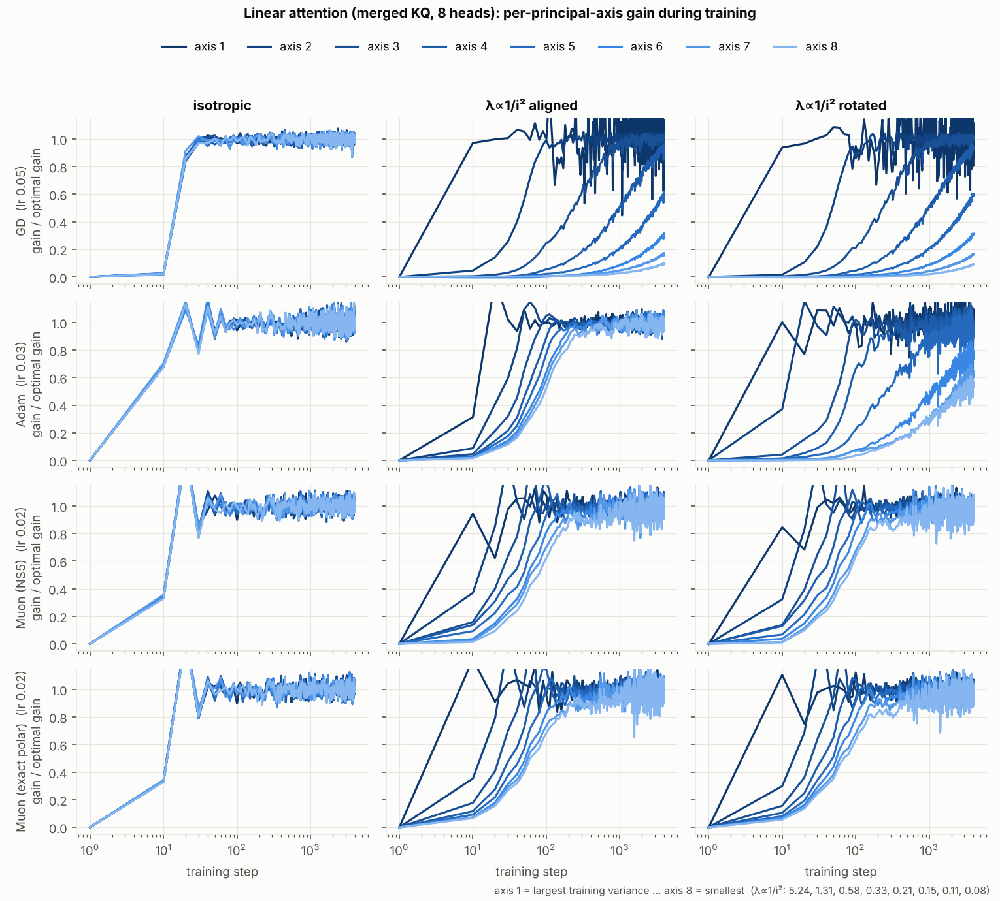
* **H3 (smaller query-shift error): supported along the path, but not at convergence.**
  - *At equal steps:* after 4,000 steps under λ ∝ 1/i², the inverted-spectrum query loss is 0.96
    for GD and 0.74 for rotated Adam, against 0.65 for Muon.
  - *At matched in-distribution loss* (the proposal's "similar ordinary error" test), Muon is
    still better: when excess loss is 0.1, the query-shift loss is 0.50 (NS5) and 0.44 (exact)
    vs 0.60 for GD and 0.57 for Adam (1/i aligned, separate K/Q). Under 1/i² aligned it is
    0.92 / 0.88 vs 0.97 / 0.97. The reason is that at equal ordinary loss a ridge-like path has
    already partly used the weak axes, while a PCR path has dropped them.
  - *At convergence* every optimizer reaches the same solution (≈0.65 under 1/i²; the optimum
    itself is not shift-robust), so the advantage is transient.

  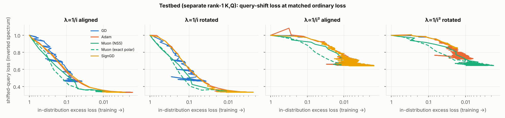
* **Caveat:** with a constant LR, Muon's normalised step never shrinks. It ends with a slightly
  higher noise floor than Adam (0.226 vs 0.222 on iso). Ma et al.'s rate assumes a decaying step
  size, so the full study should use a schedule.

## Methods (pilot and verification)

**Task (as proposed).** d = 8, prompts of 32 pairs (x_i, wᵀx_i) plus a query, fresh w ~ N(0, I) for
every prompt, noiseless; x ~ N(0, RΛRᵀ) with λ_i ∝ 1, 1/i, 1/i² rescaled to trace 8; R = I
("aligned") or one fixed Haar rotation ("rotated"). Every prefix k = 0..32 is trained and scored
(Garg-style), errors normalised so that predicting 0 scores 1. The noiseless optimum is least
squares (min-norm; it is also the Bayes estimator), which is exact once k ≥ 8.

**Model (as proposed).** 4-layer, 4-head, 128-d GPT-2 matching Garg et al.'s `TransformerModel`
(pre-LN, learned positions, 4× gelu MLP, no dropout, linear read-in/read-out), 0.80 M parameters.

**Optimizers.** SGD with momentum 0.9; AdamW (β = 0.9, 0.999); Muon from Keller Jordan's reference
(NS5 coefficients 3.4445/−4.7750/2.0315, Nesterov momentum 0.95, √max(1, rows/cols) scaling) on
the 24 hidden matrices, with AdamW (lr 1e-3) on read-in, read-out, positional embeddings, biases
and LayerNorm. Q, K and V are separate matrices so Muon orthogonalises each. Weight decay 0 for
all, 100-step warm-up, then a constant LR. Batch 64.

**Two theory checks added to the proposal's design:**
1. *A linear-attention testbed.* One-layer, 8-head linear attention (Zhang et al.'s separate
   rank-1 K/Q and merged-KQ variants, small init) on the same data, trained with GD, Adam,
   SignGD, Muon (NS5) and Muon with the exact polar factor, each with its own 5-point LR sweep and
   3 seeds. This is the setting the cited theory (Zhang et al., Ma et al.) is actually about;
   each run takes seconds, so it tests the hypotheses' premises cleanly before the GPT-2 runs ask
   whether they transfer.
2. *Implied-weight gains.* For each of 64 fixed contexts the GPT-2 is queried at 16 in-distribution
   queries and a linear map ŷ ≈ ŵᵀx_q + b is fitted (R² checks linearity). The gain on principal
   axis i, ρ_i = slope of u_iᵀŵ on u_iᵀw, is the model's per-direction "filter": all 1 = least
   squares, a 0/1 step = PCR, a smooth λ-dependent profile = ridge-like. This replaces probe
   tasks w ∝ u_i, whose y-scale is out of distribution for weak axes.

**Verification additions.**
- *Reproductions* (`icl/repro_theory.py`, `icl/linattn.py`, `scripts/garg_eval.py`):
  - Zhang et al.'s gradient flow, integrated with an adaptive ODE solver (LSODA, rtol 1e-7).
  - Ma et al.'s quadratic f(Q) on a common step-size grid for every method.
  - Deep linear networks, with one LR per method chosen on the aligned problem.
  - Garg et al.'s full evaluation suite (in-distribution, skewed covariance, noisy labels,
    half-dimensional subspace, scaled inputs, orthogonal and overlapping queries) with least
    squares, 3-NN, averaging and Bayes-ridge baselines.
  - Garg et al.'s curriculum (`--curriculum garg`: active dimensions 2 → 8, 4·dims + 1 points).
  - Xie et al.'s rotated parameter space (`--param_rotation`): Adam runs on φ with θ = Rφ, where R
    is two random permutations around a Kronecker product of three Haar rotations; RᵀR = I to
    3e-6.
- *Hyperparameter search* (`scripts/search_report.py`):
  - Per condition (isotropic and λ ∝ 1/i² aligned), ranked by area under the test-error curve over
    a fixed budget (AdamW and SGD 4k steps, Muon 3k).
  - Scored on the pilot's prompt set (seed 20000), which then counts as a selection set.
  - SGD fairness checks: LR 0.01–1.0, clipping, d = 2, and the curriculum.
- *Confirmation runs* (`scripts/confirm_jobs.py`, `scripts/analyze_confirm.py`,
  `scripts/make_confirm_figures.sh`):
  - Fresh seeds 10–12, evaluated on a held-out prompt set (seed 30000).
  - A constant-LR phase (AdamW 8k, Muon 3k), then a linear decay to 0 over 2k / 1k steps,
    branched from a checkpoint. Resuming is bit-exact (checked against an uninterrupted run).
  - Dense evaluation (every 25 steps up to 2k, then every 100). The query-shift test runs every
    500 steps and the implied-weight fit every 250.
- *Numerics check*: one seed per optimizer retrained fully in fp32.

**Deviations from the proposal, and why.**

| Proposal | What was run | Reason |
|---|---|---|
| Garg's token layout (y in coordinate 0 of the x read-in) | y in its own (d+1)-th input coordinate; Gaussian read-in init | Garg's layout makes the y coordinate coincide with the top-variance axis when R = I, confounding aligned vs rotated. With the fix, SGD and read-in-Muon are *exactly* rotation-equivariant (verified: aligned vs rotated loss trajectories agree to 1e-6), a free positive control. |
| 3 optimizers × 5 covariances × 3 seeds, 30 GPU-h | CPU only (4 cores, one run per core, ~0.22 s/step). Pilot: AdamW and Muon on 4 covariances, 1–2 seeds. Confirmation: AdamW and Muon on isotropic, 1/i² aligned and 1/i² rotated, 3 seeds (2 for Muon rotated). SGD only in the fairness checks, since it never leaves the plateau. | No GPU in the sandbox. |
| Training length (Garg: 500k steps) | AdamW 10k, Muon 4k steps, each ending in an LR decay | Budget. Muon converges by ~1.4k steps. AdamW converges by 5–6k on average (3.7–7.7k across seeds), though not on every axis. |
| LR sweep per condition | Pilot: isotropic only. Verification: per condition (isotropic and 1/i²; rotated reuses the aligned winner) | The pilot's shortcut under-tuned both optimizers on 1/i². |
| 2,000 test prompts | 1,000 test + 512 probe + 1,280 query-shift + 1,024 implied-weight prompts per evaluation set; separate selection (20000) and held-out (30000) sets | Budget; tuning and test prompts kept separate. |

## Methodological findings (fix these before the full run)

1. **Garg's token layout breaks the symmetry the aligned-vs-rotated comparison relies on.** We showed this is real but did not measure its practical size; AdamW's rotation effect in this GPT-2 is null anyway (step 3). Garg's code writes y into
   coordinate 0 of the same read-in as x. With R = I that coordinate is also the top-variance input
   axis; under a rotation it is not. Giving y its own (d+1)-th coordinate, with an iid-Gaussian
   read-in init, makes SGD — and Muon if it also updates the read-in — **exactly**
   rotation-equivariant. We checked this pathwise: with matched seeds, aligned and rotated
   training losses agree to 2e-6 (SGD) and 1e-6 (Muon incl. read-in) over 40 steps, against 2.5e-2
   for AdamW and 1.0e-1 for standard Muon, whose read-in uses AdamW. Consequences:
   - The rotated condition is a free replicate for SGD, i.e. a positive control.
   - Only AdamW, and the AdamW-updated parts of Muon, can tell aligned from rotated. Muon with an
     AdamW read-in is *not* rotation-invariant.
   - Rotating only the inputs touches only the read-in's input side. Expect a much smaller Adam
     effect than Xie et al.'s full parameter rotation.
2. **The ICL plateau is long and LR-sensitive, so tune per condition.**
   - On isotropic inputs (one seed per LR, 3–4k steps) the adaptive optimizers stall completely
     above a threshold: AdamW at 3e-3, Muon at 0.02 and 0.05.
   - Below the threshold, escape time varies non-monotonically with LR (AdamW: 1,200–2,400 steps
     across 1e-4 … 1e-3). Part of this is seed noise: three fresh seeds at one LR spread
     1,075–1,300.
   - The best LR also differs by condition. The pilot's isotropic choices were too small for
     λ ∝ 1/i²: AdamW 3e-4 → 5e-4, and Muon 0.005 → 0.007.
   - Sweep a decade below the usual defaults (Muon's reference LR is 0.02), select by area under
     the learning curve on separate prompts, and tune each condition.
   - **Expect large seed-to-seed variance for AdamW on skewed spectra.** One of three seeds had not
     learned the weakest axis after 8k steps, so budget ≥ 3 seeds.

   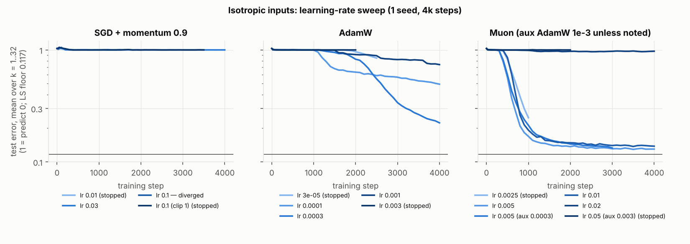
3. **Garg et al.'s curriculum cannot simply be reused.** Its dimension curriculum zeroes raw
   coordinates, which distorts rotated spectra. Zeroing the low-variance axes first would bake the
   effect being tested into the data. A points-only curriculum is safe.
4. **Reference estimators need care in the noiseless setting.** Ridge(λ→0) = least squares =
   the Bayes estimator here, so "ridge-like" has to mean a fitted λ > 0 (we report the best-fitting
   λ per checkpoint). Plain least squares restricted to the top-m axes explodes near k = m
   (normalised error 618 at k = 1, m = 1). Use either the Bayes version (subspace ridge with
   penalty Σ_{j>m} λ_j) or Zhang et al.'s finite-N form, which is one-step preconditioned GD with
   c_i = N/((N+1)λ_i + trΛ). The latter matches its analytic error (0.1619 vs 0.1610 on
   200k prompts).
5. **Probe tasks w ∝ u_k are out of distribution in scale** for weak axes (Var y = dλ_k), and
   64 probes per axis give ±0.18 noise per position. Ratio-normalised errors and the
   implied-weight gains (fit ŷ ≈ ŵᵀx_q per context) are better per-direction measures. An OLS
   oracle recovers gain 1 and error 1e-15 exactly.
6. **Muon details matter for the weak directions.** NS5 does not equalise singular values below
   ~1e-3 of the Frobenius norm. In the testbed the weakest axis takes 160 steps with NS5 vs 90
   with the exact polar factor. With a constant LR, Muon also keeps a noise floor. Run an exact-SVD
   ablation and use an LR schedule.
7. **Compute.** The 0.80M-parameter model takes 0.22 s/step on one CPU core (bf16 linears, fp32
   attention). A GPU should be far faster per step; measure first, as the proposal says.

## Literature check: do the cited papers say what the proposal says?

Three review passes covered all 11 papers plus the Garg, Raventós and Muon code. Depth varies:
Garg, Raventós, Singh, Zhang (full PDF + code), Ma (full PDF) and the Muon / Garg / Raventós /
von Oswald code were read directly; Xie, Aranda, Dragutinović, Olsson, Wang–Shi–Fox and parts of
Garg were checked from abstracts, HTML extracts and code only (arXiv and OpenReview were not
reachable from the sandbox).

| Paper | Proposal's claim | Verdict | What matters for the project |
|---|---|---|---|
| Garg et al. 2022 | near-LS on isotropic inputs; on skewed inputs the error stops falling while LS keeps improving | **Accurate** | Their skewed test used Cov ∝ 1/i² with a *random rotation*, applied to context **and** query, on a model trained only on isotropic inputs (d = 20; the plateau starts near k ≈ 10). Code: y sits in coordinate 0 of the same read-in as x; Adam (not AdamW) 1e-4, batch 64, 500k steps, dims+points curriculum done by step 30k; 12L/8H/256. |
| Olsson et al. 2022 | induction heads form in an abrupt phase change seen as a loss bump | **Accurate** | Causal evidence only for small attention-only models. |
| Raventós et al. 2023 | task-diversity threshold: Bayes for the finite pool below, ridge above | **Accurate** | d = 8, 16 points, noise σ = 0.5 so ridge λ = 0.25. Code is JAX; the estimators must be ported (≈15 lines each). With fresh tasks and no noise, ridge(λ→0) = least squares = the Bayes estimator, so "ridge-like" needs an explicit definition here. |
| Singh et al. 2023 | emergent ICL can be transient | **Accurate** | Omniglot bursty sequences. Transience needs a memorisable alternative; with a fresh w per prompt there is none, so it is not expected in this setup. |
| von Oswald et al. 2023 | a trained linear self-attention layer = one GD step | **Accurate** (one layer, concatenated tokens, isotropic x) | With anisotropic x the right reference is *preconditioned* GD; deeper models implement GD++; interleaved x/y tokens need a copy layer first. |
| Wang, Shi & Fox 2025 | linear attention, SSMs, softmax attention as test-time key→value regression | **Accurate** | Softmax attention is a locally-constant (Nadaraya–Watson) regressor; linear attention is linear regression *without* the covariance inverse. |
| Zhang et al. 2025 | merged K–Q: one abrupt drop; separate K, Q: one principal direction at a time, i.e. PCR on a growing set | **Partly accurate** | The staircase needs rank-1 heads, small init and distinct eigenvalues; the exact solution covers only merged weights with white inputs. "PCR" is the N→∞ reading: at finite N each plateau is one-step *preconditioned GD* on the top-m axes, ŷ = x_qᵀ Σ_{i≤m} c_i u_i u_iᵀ β with c_i = N/((N+1)λ_i + trΛ) (their eq. 22). With head dimension ≥ d (ours: 32 ≥ 8) the theory predicts a **single** drop even under GD. Gradient flow / plain GD only — no Adam or Muon. |
| Xie et al. 2025 | rotating GPT-2's parameter space slowed Adam sharply but not SGD | **Partly accurate** | Rotated Adam was much slower (worse than AdaSGD). SGD was not run rotated — it is invariant by construction. They rotated *all* parameters; rotating only the inputs (this design) touches only the read-in's input side, so expect a much smaller effect. |
| Aranda et al. 2026 | Muon learns imbalanced sub-tasks more in parallel | **Accurate** (abstract level) | ICML 2026 HiLD workshop paper on multitask sparse parity; compares Muon with Adam and normalized momentum descent — not SGD. |
| Ma et al. 2026 | simplified Muon trains linear transformers on ICL regression at a condition-number-free rate, unlike GD and SignGD | **Accurate**, narrow scope | One-layer linear attention with merged KQ and only Q trained, fixed design, exact polar factor, no momentum, geometrically decaying step size. With an axis-aligned covariance and zero init, SignGD's iterates *equal* Muon's — so the theory predicts Adam ≈ Muon when aligned and Adam slower when rotated. |
| Dragutinović et al. 2026 | simplified Muon trades GD's simplicity bias for speed; worse generalisation when tasks share structure | **Accurate** in gist | Spectral GD in deep linear networks (GD learns singular modes sequentially; spectral GD all at once). Does not predict the opposite of H3 for noiseless fresh-task ICL; it would with label noise or a finite task pool. |
| Proposal's Methods | "Following Garg et al. … N = 32, x ∈ R⁸ … 4-layer, 4-head, 128-d GPT-2 built on Garg's code … reuse reference-estimator code from Raventós" | **Partly accurate** | d = 8, N = 32 and 4L/4H/128 are not Garg's settings (d = 20, 41 points, 12L/8H/256); d = 8 matches Raventós. Garg's code hard-codes `.cuda()` and Adam; Raventós's estimators are JAX. |

## Recommended changes for the full study

*Update:* the section "A better experiment, given the negative results" supersedes items 1, 2 and 12 where they conflict.
- SGD can be trained in the GPT-2 with concatenated tokens and hidden init 1/√width.
- The rotation arm should be a negative control.
- Transience is demoted.
- The recommended study is optimizer × batch size × input spectrum, read out as the spectral learning exponent.

1. **Decide what replaces SGD.** SGD cannot form the ICL circuit in this GPT-2 (step 2), so H2 and
   H4 as written cannot be tested on it. Options, best first:
   - (a) State H2 and H4 for "non-orthogonalised optimizers", with AdamW as the comparison.
   - (b) Test SGD where it does learn: the linear-attention testbed, where its staircase is
     predicted and observed.
   - (c) ~~SGD with per-block learning rates~~ was tested in the follow-up (question 1) and does
     not work. Normalised SGD, with Muon's exact per-matrix step size, still never leaves the
     plateau. So does SGD on the hidden matrices with AdamW on everything else. If an
     "SGD-family" arm is wanted, normalised SGD is the informative one: it is Muon without the
     orthogonalisation.
2. **Use the corrected token layout** (y in its own coordinate, Gaussian read-in init; `--y_mode sep
   --readin_init gauss`). Add **Muon with the read-in included**, the only exactly
   rotation-invariant Muon arm, if the aligned-vs-rotated contrast stays in the study. Otherwise
   drop the rotation: it is a confirmed null for AdamW here, and only a full parameter rotation
   (Xie et al.) moves it. The follow-up (question 3) found no effect even with an identity
   read-in that hands the input axes to every hidden layer, so dropping it is the better choice.
3. **Tune per condition and select on separate prompts.** Start from the verified values (AdamW
   5e-4; Muon 0.005 isotropic, 0.007 under 1/i²; aux AdamW 1e-3). Sweep at least a decade below
   the usual defaults: AdamW stalls at 3e-3, Muon at 0.02. Rank by area under the learning curve
   and keep a held-out prompt set for the final numbers.
4. **Use a constant-then-decay schedule with branches.** Read timing (H1, H2) from the
   constant-LR phase and end states (final error, H3, Garg's suite) from decay branches. Resuming
   is bit-exact in this code (`--resume`, `--schedule decay`).
5. **Train much longer for end-state claims.** Two of six AdamW 1/i² runs still ignored the
   weakest axis after 10k steps. Whether AdamW eventually reaches least squares on every axis
   decides whether H3 is a lasting difference or a transient one, as in the testbed. Budget
   50k–100k+ steps on a GPU.
6. **Seeds:** ≥ 3 per cell, and ≥ 5 for AdamW on skewed spectra, whose weak-axis times and
   end states vary several-fold across seeds.
7. **Measure per-direction learning with implied-weight gains**, not only probe tasks; probe tasks
   are out of distribution in scale for weak axes. Test H3 at **matched in-distribution error**,
   and report how many seeds reach each level.
8. **Run Garg et al.'s full evaluation suite on every final model.** It is cheap. With more seeds,
   it can test the new observation that Muon-trained models resist the skewed-covariance failure.
9. **Keep the reproductions as regression tests** for the full-scale code: Zhang's plateau values,
   the exact equivariance checks, Xie's parameter-rotation control, and Garg's suite. If a code
   change breaks one, the new results should not be trusted.
10. **Reference estimators:** least squares, the fitted ridge path, Bayes-PCR(m), and Zhang et
    al.'s finite-N one-step preconditioned GD. Consider one run family with label noise σ > 0,
    where "ridge-like" differs from least squares in a principled way (Raventós et al.'s
    setting).
11. **Tighten the background section** (see the literature table):
    - Zhang's staircase needs rank-1 heads and small init.
    - Xie did not run SGD rotated.
    - Aranda et al. is a workshop paper comparing Muon with Adam and NMD.
    - Ma et al.'s result is for a one-layer linear model with exact orthogonalisation and a
      decaying step size.
12. **If transience is part of the study** (follow-up question 4):
    - Use a finite task pool with label noise, scored against exact ridge and dMMSE references
      (`--n_tasks`, `--noise`; `icl/transience.py`).
    - Compare optimizers at matched training loss or on a log-step axis, never at a fixed step
      count. Muon runs the same trajectory about 2.5× faster, so a fixed budget makes it look more
      transient.
    - At this scale, pools of 16–32 tasks show the full transition within 32k AdamW steps. At 64
      tasks only Muon has started to decline by 16k steps, and at 256 neither has.
    - Add weight decay as a factor (Singh et al.), and use ≥ 3 seeds.

## Appendix — the pilot's original GPT-2 results (superseded by verification step 3)

*Kept for transparency. These runs used learning rates tuned only on isotropic inputs and mostly one seed, evaluated on the selection prompts. Verification step 3 replaces them.*

LRs tuned on isotropic inputs (Muon 0.005 with aux AdamW 1e-3; AdamW 3e-4; SGD 0.1 with
gradient clipping 1.0, its best stable setting), then reused on every covariance. One seed per
cell unless noted. "Converged" = error averaged over k = 1..32 within 0.05 of least squares.
"Axis learned" = relative error on that axis's probe tasks below 0.5.

Seed-1 values, where run, are in brackets. SGD was run only on isotropic inputs.

| covariance | optimizer | leaves plateau | half-way | converged | weakest axis learned | axis-8/axis-1 time | in-dist. error @32 | shifted-query error (t=1) | PCR/ridge fit ratio |
|---|---|---|---|---|---|---|---|---|---|
| isotropic | SGD | – | – | – | – | – | 1.036 | 1.002 | – |
| isotropic | AdamW | 1,900 | 2,500 | 5,600 | 2,500 | 1.0 | 0.014 | 0.008 | 1.71 |
| isotropic | Muon | 400 (400) | 600 (500) | 1,100 (1,200) | 500 (500) | 0.8 (0.8) | 0.009 (0.009) | 0.005 (0.006) | 1.69 (1.66) |
| 1/i aligned | AdamW | 400 | 1,100 | 5,600 | 2,600 | 5.2 | 0.014 | 0.027 | 1.75 |
| 1/i aligned | Muon | 300 | 400 | 1,000 | 600 | 2.0 | 0.005 | 0.008 | 1.55 |
| 1/i² aligned | AdamW | 200 (300) | 300 (300) | 6,700 (6,600) | 8,500 (7,800) | 42.5 (26.0) | 0.009 (0.013) | 0.174 (0.182) | 0.88 (0.88) |
| 1/i² aligned | Muon | 200 (300) | 300 (300) | 900 (900) | 900 (900) | 3.0 (3.0) | 0.006 (0.004) | 0.065 (0.033) | 1.21 (1.23) |
| 1/i² aligned | Muon + read-in | 200 | 300 | 1,200 | 1,800 | 6.0 | 0.004 | 0.045 | 1.11 |
| 1/i² rotated | AdamW | 200 | 300 | 6,300 | 7,400 | 37.0 | 0.009 | 0.135 | 0.84 |
| 1/i² rotated | Muon | 200 | 300 | 1,000 | 1,000 | 3.3 | 0.004 | 0.043 | 1.24 |
| 1/i² rotated | Muon + read-in | 300 | 300 | 1,400 | 1,800 | 6.0 | 0.004 | 0.045 | 0.88 |

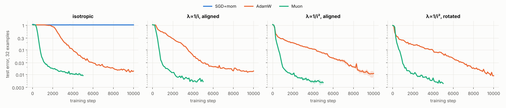
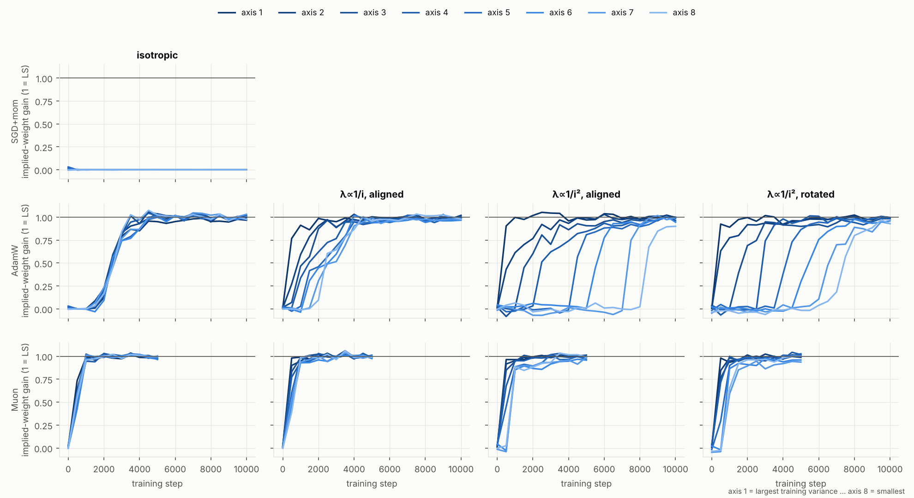
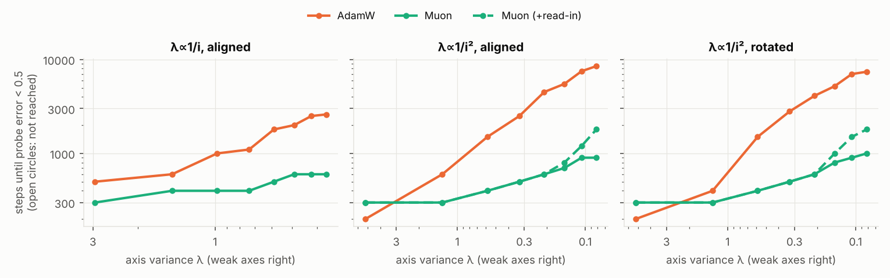
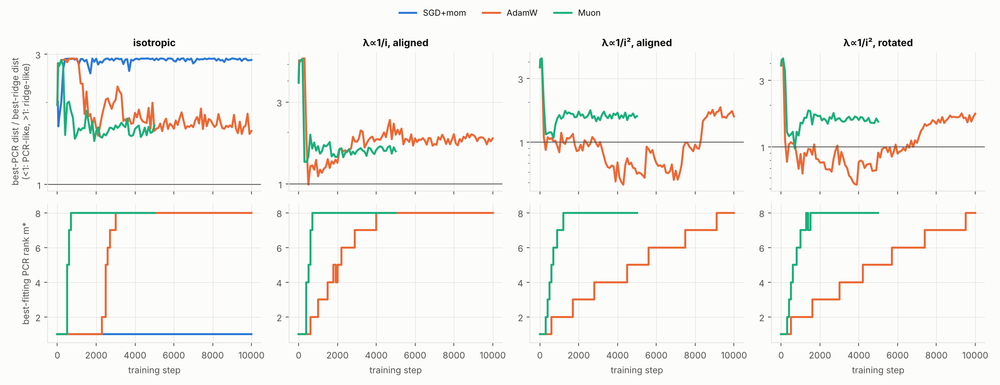

* **H1 (Muon reaches ICL earlier): supported, large effect.**
  - On isotropic inputs Muon leaves the predict-zero plateau at step ~400 and converges by
    ~1,100. AdamW does so at ~1,900 and ~5,600.
  - SGD + momentum never left the plateau in 10,000 steps, nor at lr 0.01 or 0.03 in 4,000.
  - Across all four covariances Muon converges 5–7× sooner than AdamW (900–1,100 vs
    5,600–6,700 steps).
  - The gain comes from Muon's updates to the hidden matrices. With its auxiliary AdamW LR
    lowered to AdamW's own 3e-4, Muon still escapes by ~500 steps (error 0.21 at step 1,000 vs
    0.17).
  - Caveat: "first escape" is earlier on skewed spectra for both optimizers (step 200 under
    1/i²), because one dominant axis is easy to learn. Compare convergence and weakest-axis
    times, not first escape.
* **H2 (imbalance slows SGD more than Muon): supported with AdamW in SGD's place.** SGD never
  leaves the plateau even on isotropic inputs, so it cannot be scored here. AdamW is clearly
  slowed by imbalance and Muon barely is: weakest-axis time 2,500 → 2,600 → 8,500 steps for
  AdamW (isotropic → 1/i → 1/i²; 7,800 with the second seed) vs 500 → 600 → 900 for Muon
  (both seeds). The ratio of last-axis to first-axis time grows 1 → 5 → 26–42 for AdamW and only
  1 → 2 → 3 for Muon.
* **Aligned vs rotated: no effect in the GPT-2.** AdamW converges at 6,700 (aligned) vs 6,300
  (rotated) steps, learns the weakest axis at 8,500 vs 7,400, and the curves overlap. In the
  testbed, rotation slowed Adam 6.5×. Only the read-in sees the input basis, and AdamW's
  hidden-layer coordinates are random relative to it. As designed, R is a near-null
  manipulation for this architecture.
* **H4 (SGD → PCR on a growing set, Muon → ridge-like): the staircase is real, but it belongs to
  AdamW.**
  - Under 1/i², AdamW learns the principal axes one at a time, in eigenvalue order (steps 200,
    600, 1,500, 2,500, 4,500, 5,500, 7,500, 8,500). The best-fitting PCR rank climbs 1 → 2 → … → 8 at roughly one rank per 1,200 steps (rank 8 at step 9,000), aligned and rotated alike, and PCR fits its predictions better than any ridge λ from step ~1,000 until rank ≈ 7 (median distance ratio 0.88 aligned, 0.84 rotated).
  - Muon learns all eight axes within ~3× of each other (300–900 steps) and is fit better by
    ridge (ratio 1.21 / 1.24). This matches the testbed and Ma et al.'s λ-proportional filter.
  - On isotropic and 1/i inputs both optimizers are ridge-like (ratios 1.5–1.75).
  - SGD's predicted staircase cannot appear here, because SGD never forms the first
    (copy-x-into-the-y-token) circuit. Head alignment shows its key-side input map stays at
    R² ≈ 0.01 in every layer.
* **H3 (Muon more robust to queries on weak axes): supported, including at matched ordinary
  error.**
  - At the end of training on 1/i², in-distribution error is ≈0.004–0.013 for both, but the
    inverted-spectrum query error is 0.174 / 0.182 (AdamW, two seeds) vs 0.065 / 0.033 (Muon)
    aligned, and 0.135 vs 0.043 rotated. AdamW was trained twice as long (10k vs 5k steps).
  - At matched in-distribution error (≈0.007–0.009) it is 0.23 vs 0.12 aligned and 0.135 vs
    0.117 rotated. Under 1/i the two trajectories overlap, so the effect grows with imbalance
    (figure below).
  - AdamW's final implied-weight gain on the weakest axis is 0.90 vs 0.99 for Muon. The
    training loss barely penalises this (axis 8 carries 1% of the variance), but shifted
    queries expose it.

  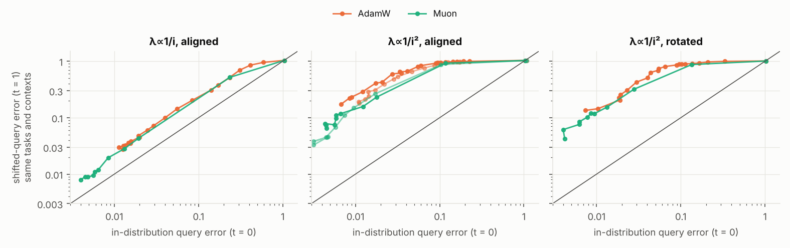
* **Muon with the read-in included (the exactly rotation-invariant arm).** Aligned and rotated
  runs are indistinguishable (weakest axis learned at step 1,800 in both, shifted-query error
  0.045 in both), as equivariance requires. Moving the read-in from AdamW to Muon slows the weakest
  axes about 2× relative to standard Muon (1,800 vs 900–1,000 steps), so the AdamW-updated read-in
  helps the weak directions. Even so, it is 4–5× faster on them than AdamW.
* **Replication.** Second seeds closely reproduce the first:
  - Muon on isotropic inputs escapes at 400 and converges at 1,200 vs 1,100.
  - Muon on 1/i² aligned learns the axes at the same steps (300 … 900).
  - AdamW on 1/i² aligned repeats the staircase: axes at 300, 500, 1,300, 2,700, 4,400, 5,200, 6,600 and 7,800 (seed 0: 200 … 8,500). It converges at 6,600 vs 6,700, ends at shifted-query error 0.182 vs 0.174, and has the same PCR/ridge ratio of 0.88.
* **Head alignment (exploratory).** On isotropic inputs, both optimizers develop layer-2 heads
  that are almost exactly diagonal in the whitened principal basis (share 0.97–0.99), spread
  evenly over the eight axes: an x_qᵀΣ⁻¹x_k-style comparison after a layer-1 copy step. Under
  1/i², both concentrate on the top axes; AdamW more so (rotated, layer 3: 0.48 / 0.25 on axes
  1–2 and ≈0 on axes 7–8, vs 0.30 / 0.16 … 0.07 / 0.07 for Muon).

